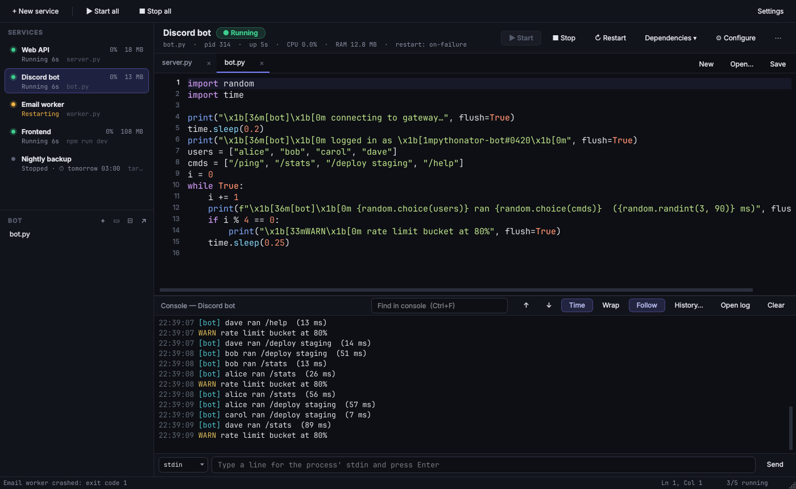
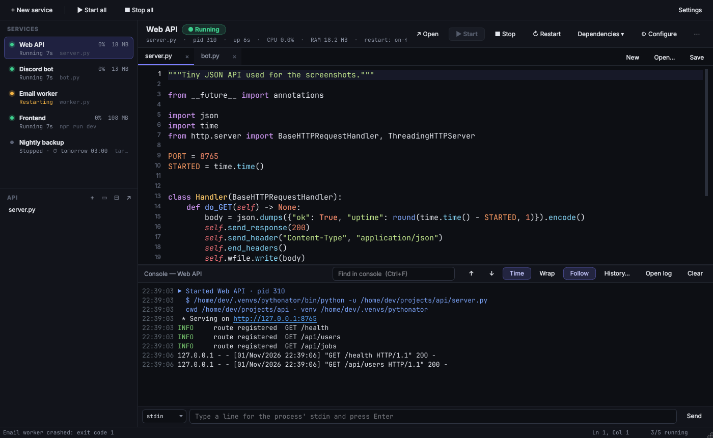
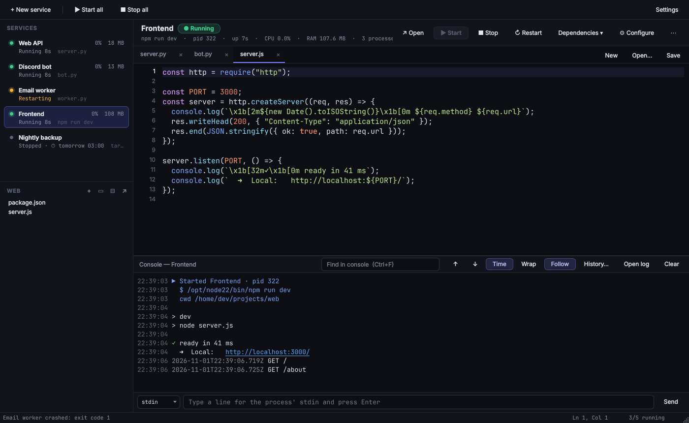
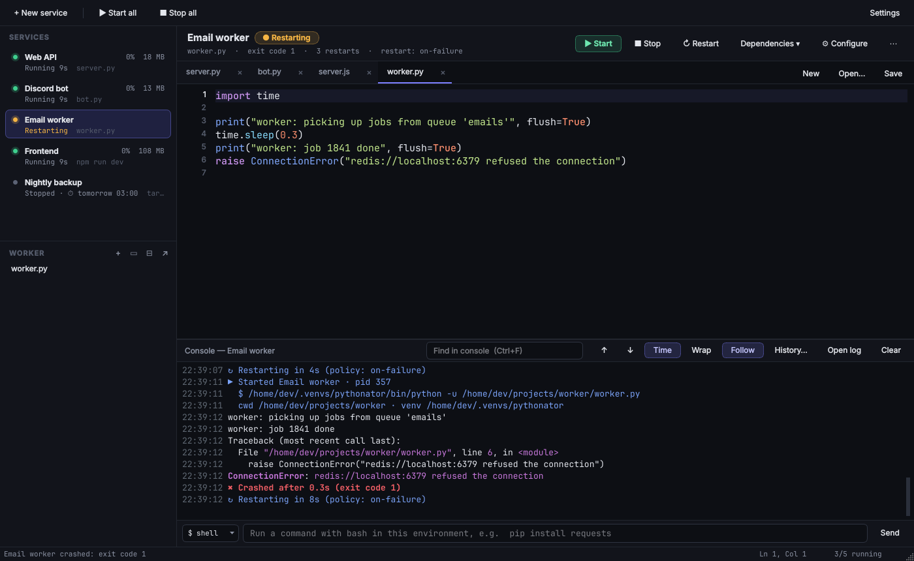
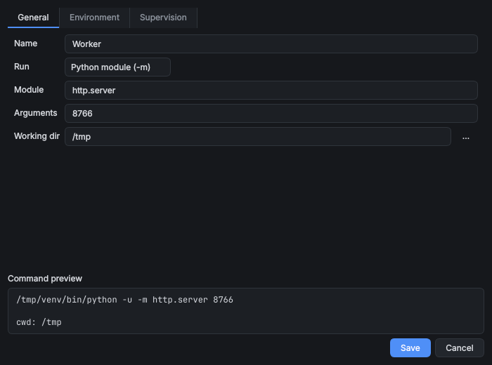

<p align="center">
  
  
  
  
  
  
</p>

<p align="center">
  <a href="https://github.com/cfunkz/Pythonator/stargazers">
    
  </a>
  <a href="https://github.com/cfunkz/Pythonator/issues">
    
  </a>
</p>

<p align="center" style="margin-top: 12px;">
  <a href="https://ko-fi.com/cfunkz81112">
    <strong>Buy me a coffee ☕</strong>
  </a>
</p>

# Pythonator

**Pythonator** is a fast desktop supervisor for long-running processes: web servers, Discord/Telegram bots,
workers, scrapers, schedulers. It runs **Python, Node.js, Bun, Deno, Go, Java, .NET, Ruby, PHP, shell and
PowerShell scripts, or any program**, on Windows, macOS or Linux directly, with no Docker containers and no WSL. Each
service gets its own environment, a live colour console, crash recovery and a built-in code editor in the same
window.

<p align="center">
  
</p>

---

## Features

**Supervision**
* Run any number of services at once, mixing runtimes. Each one runs a script, its runtime's named entry point,
  or any command:

  | Runtime | Script | Entry point | Install dependencies |
  | --- | --- | --- | --- |
  | **Python** | `python -u bot.py` | `python -m uvicorn …` | `pip install` into the venv |
  | **Node.js** | `node bot.js` (`.mjs`, `.ts`) | `npm run start` (pnpm / yarn / bun by lockfile) | `npm install` / `add` |
  | **Bun** | `bun run server.ts` | `bun run dev` | `bun install` / `bun add` |
  | **Deno** | `deno run -A main.ts` | `deno task start` | `deno install` / `deno add` |
  | **Go** | `go run main.go` | `go run ./cmd/bot` | `go mod tidy` / `go get` |
  | **Java** | `java -jar server.jar` (or one `.java` file) | `java -cp . com.example.Bot` | (Maven / Gradle) |
  | **.NET** | `dotnet run --project Bot.csproj`, `Bot.dll`, `app.cs` | | `dotnet restore` / `add package` |
  | **Ruby** | `ruby bot.rb` (unbuffered) | `bundle exec puma` | `bundle install` / `gem install` |
  | **PHP** | `php worker.php` | `php -S localhost:8000` | `composer install` / `require` |
  | **Shell** | `bash run.sh`, `.bat` / `.cmd` on Windows | | |
  | **PowerShell** | `pwsh -File task.ps1` | | |
  | **Program** | any executable: `caddy`, `redis-server`, `.exe`, AppImage, macOS `.app` | | |

  Runtimes are found on PATH and in their usual install folders (`~/.bun/bin`, `/usr/local/go/bin`, `JAVA_HOME`,
  Git Bash on Windows, Homebrew and `java_home` on macOS, ...), or you set the interpreter per service. **Runtime options** go to the interpreter
  itself, e.g. `-Xmx4G` for Java or `--max-old-space-size=4096` for Node. Adding a language is one entry in
  [`core/runtimes.py`](pythonator/core/runtimes.py).
* **Restart policies** (never / on failure / always) with exponential back-off (1s → 60s) for crash loops
* **Clean shutdown of the whole process tree.** Every service runs in its own process group: Stop sends
  SIGTERM (CTRL+BREAK on Windows), waits a configurable grace period, then kills everything it spawned.
  Workers left behind after a crash are cleaned up too, so ports are free for the next start.
* **Schedules** for jobs that run and finish: `every 15m`, times of day (`09:00, 18:30`) or cron
  (`0 3 * * mon-fri`, `@daily`). A run is skipped if the previous one is still going.
* **Autostart** services when Pythonator opens, and keep them running from the **system tray** (the **menu bar** on
  macOS) when the window is closed
* **Start Pythonator at login** (Settings), minimized to the tray, so your bots and servers come back after a reboot:
  a LaunchAgent on macOS, an XDG autostart entry on Linux, the Run key on Windows
* Live **CPU / RAM / uptime / pid** per service tree, sampled on a background thread

**Environment**
* Python: per-service **virtual environment**, auto-detected (`.venv` / `venv`) in the working directory; create it
  and `pip install` with one click
* Node.js: `node_modules/.bin` (of the project and its parents) is on PATH; **Install dependencies** runs
  `npm install` (or pnpm / yarn / bun), or adds the packages you list; pick a specific `node` binary per service
* **📦 Dependencies** button for every language: **Create** a starter `requirements.txt`, `package.json`,
  `deno.json`, `go.mod`, `Gemfile` or `composer.json` if the project has none, **Edit** it in the built-in editor,
  then **Save and install dependencies** (unsaved edits are saved first)
* **Version fixes**: when an install fails because a pinned version doesn't exist for your Python (say
  `numpy==1.26.0` on 3.13), the console names the closest available version and asks *y/n* before changing the
  file and installing again. If a pinned package fails to build, it looks up versions with ready-made wheels
  first. For npm / pnpm / yarn / bun it offers `package@latest`.
* Per-service **environment variables** (`KEY=value`, `$VAR` expansion), working directory and interpreter
* **`.env` files**: point a service at `.env` (picked automatically when one sits next to the script) to keep
  tokens out of the config; variables set on the service override it
* **`$ shell` console mode**: run `pip list`, `alembic upgrade head`, `npx prisma migrate deploy`, ... inside the
  service's environment, with output streamed into the console. **Stop** ends a long-running command too
  (`python -m http.server`, `npm run dev`), and pressing it again kills one that won't quit.
  * On Windows commands run in **PowerShell** by default, so `mv`, `ls`, `rm`, `cp` and `cat` from README
    instructions work. Pick cmd or Git Bash in **Settings → Console $ shell** (bash or PowerShell elsewhere).
  * A **pasted block of several lines** runs as one script and stops at the first line that fails.
  * When a command doesn't exist, the console says why: Docker not installed, `apt` / `sudo` being Linux commands
    on Windows, or a tool installed after Pythonator started (restart it to pick up the new PATH).
* **stdin mode**: type into a running process (`input()` prompts, REPL-style bot commands)

**Console & logs**
* Fast ANSI console: 16/256/true colour, bold, italic, underline. Progress bars using `\r` collapse correctly.
* Output is read and split into lines on background threads; the GUI only renders what's new, about 12 times a second,
  so a process printing 100k lines/s can't freeze the window
* Find in console, follow mode, timestamps, wrap
* Every line is persisted to **rotating log files** (size and count configurable). **History search**
  covers all of them off the GUI thread.
* **Double-click a stack-trace line** (Python, Node, Go, Java, .NET, Ruby, PHP, shell) to open the file at that line in the editor
* **Clickable links**: URLs in the output open in your browser, and when a web server prints its address
  (`Running on http://127.0.0.1:5000`, `Local: http://localhost:5173/`) an **Open** button appears in the header

**Files & editor**
* **Folder tree** of the selected service's project: open files, create files and folders, rename (F2), move to
  trash, copy paths, run a script as a new service. Cache folders like `__pycache__` and `.git` are hidden.
* Tabs, highlighting for Python, JavaScript/TypeScript, Go, Java, C#, Ruby, PHP, Rust, shell, batch and PowerShell, line numbers, smart indent, `Ctrl+/` comment toggle,
  find & replace, go to line
* Python completion via [jedi](https://github.com/davidhalter/jedi) (optional), using **the service's own venv**
* Atomic saves, reloads files changed on disk, and saves your edits automatically on Start/Restart (F5)

<p align="center">
  
</p>

<p align="center">
  
</p>

<p align="center">
  
  
</p>

**Reliability**
* A bug in Pythonator can't take your services down with it: unexpected errors are written to
  `logs/pythonator.log` and shown in a dialog, and the app keeps running
* A service that can't start (missing interpreter, deleted folder, bad permissions) says why in its console
  instead of failing silently; supervision loops and stats sampling recover from any error
* The config is written atomically with a `.bak` copy. A damaged config is restored from the backup, and one
  that can't be read is never overwritten.
* Very long output lines are split instead of eating memory; a full disk stops log files, never the service
* The editor refuses binary, non-UTF-8 and huge files rather than corrupting them

---

## Getting started

Requires **Python 3.11+** on Windows, macOS (11 or later, Apple silicon or Intel) or Linux. For other languages, install their runtime as
usual ([Node.js](https://nodejs.org), [Go](https://go.dev/dl/), a JDK, the .NET SDK, Ruby, PHP, ...); Pythonator
finds it on PATH or in its standard install folder.

```bash
git clone https://github.com/cfunkz/Pythonator.git
cd Pythonator
pip install -e .            # or: pip install -r requirements.txt
pythonator                  # or: python -m pythonator / python app.py
```

**Smart Python completion** uses [jedi](https://github.com/davidhalter/jedi). `pip install -r requirements.txt`
includes it; with `pip install -e .` add it with `pip install -e ".[completion]"` (or `pip install jedi`), in the
Python that runs Pythonator, then restart. Your services' venvs don't need it: jedi reads the packages installed
in each service's own venv. Suggestions pop up after `.` or three letters, or press `Ctrl+Space`. Without jedi the
editor completes words from the current file, and says so once when you open a Python file.

### Typical workflow

1. **New service** (or drop a `.py`, `.js`, `.go`, `.rb`, `.php`, `.sh`, ... file onto the window), pick the
   runtime and a script, entry point or command
2. Use the **📦 Dependencies** button in the header (also in the ⋯ menu). For Python, pick **Create venv**, then
   **Install dependencies** (your list, or `requirements.txt`). Other runtimes only need **Install dependencies**
   (your list, or `package.json`, `go.mod`, `Gemfile`, ...). **Edit package.json** (or whichever file the project
   uses) opens it in the editor, and **Create ...** makes a starter file if there is none. Add packages, then
   **Save and install dependencies**.
3. **Start** (F5). Watch the console, edit the code above it, and press F5 to save and restart.
4. Set **Restart: on failure** and **Start automatically** for anything that should always be up, or a
   **Schedule** (Configure → Supervision) for jobs like backups and reports
5. Close the window and choose **Keep running in the system tray** (**menu bar** on macOS). To have everything come
   back after a reboot, turn on **Settings → Start Pythonator when I log in**.

### Keyboard shortcuts

| Shortcut | Action |
| --- | --- |
| Windows / Linux | macOS | Action |
| --- | --- | --- |
| `F5` / `Shift+F5` | `⌘R` / `⌘.` (or `F5` / `⇧F5`) | Start or restart / stop the selected service (press Stop twice to kill) |
| `Ctrl+Shift+N` / `Ctrl+E` | `⇧⌘N` / `⌘E` | New service / configure the selected service |
| `Ctrl+S`, `Ctrl+Shift+S`, `Ctrl+O`, `Ctrl+W` | `⌘S`, `⇧⌘S`, `⌘O`, `⌘W` | Save, save as, open, close tab |
| `Ctrl+F`, `Ctrl+H`, `Ctrl+G` | `⌘F`, `⌥⌘F`, `⌘L` | Find (editor or console), replace, go to line |
| `Ctrl+Space`, `Ctrl+/`, `Ctrl+D` | `⌃Space`, `⌘/`, `⌘D` | Complete, toggle comment, duplicate line |
| `Ctrl+1` / `Ctrl+2` / `Ctrl+3` | `⌘1` / `⌘2` / `⌘3` | Focus services / editor / console input |
| | `⌘,` | Settings |
| `Ctrl+Q` | `⌘Q` | Stop all services and quit |
| `↑` / `↓` in the console input | same | Command history |

Tooltips show each shortcut the way your system writes it.

---

## Where data lives

| | Location |
| --- | --- |
| Windows | `%APPDATA%\Pythonator\` |
| macOS | `~/Library/Application Support/Pythonator/` |
| Linux | `~/.config/pythonator/` |
| Portable | next to the app, if a `pythonator.json` (or a 1.x `bots.json`) is already there |
| Override | `PYTHONATOR_HOME=/some/dir` or `pythonator --home /some/dir` |

It contains `pythonator.json` (config, written atomically), `logs/` (one rotating log per service, plus `pythonator.log` for the app itself) and
`requirements/`. **Upgrading from 1.x:** your `bots.json` is migrated automatically on first start and left
untouched as a backup.

On Linux and macOS the config, its backup and the `logs/` folder are readable by your account only, because
service environment variables and output often contain tokens. Prefer a `.env` file in the project (kept out
of git) over typing secrets into the service settings.

---

## Safety

Pythonator runs your services with **your own account's rights**: it is a supervisor, not a sandbox, so only run
code you trust. On top of that it:

* **Asks before risky things:** starting as root / Administrator, the first “Install dependencies” of a project
  (package installs run their own setup code), `$ shell` commands that look destructive (`rm -rf /`, `format c:`,
  `curl … | sh`, `shutdown`, …), deleting files from the folder tree (to the trash first; permanent delete is
  asked separately), and autostarting services when the settings folder could have been changed by another user.
* **Never runs anything through a shell by accident:** services and installs are started from an argument list.
  On Windows, `.bat` / `.cmd` files (including `npm.cmd`) get every argument quoted for cmd.exe, so an argument like
  `a&calc` stays an argument.
* **Keeps secrets out of logs:** what you type at a `Password:` / `Token:` prompt is logged as `••••••••`, and env
  vars are never printed.
* **Opens only web links** (http/https) from console output, and file-tree names can't reach outside the folder.
* **Cleans up:** stopping a service stops its whole process tree, and quitting Pythonator stops everything it
  started (unless you keep it running in the tray). On macOS that includes `⌘Q`, Dock → Quit and logging out.

---

## Architecture

```
pythonator/
├── core/            Qt-free and unit-tested
│   ├── models.py    typed dataclasses for services and settings (tolerant JSON parsing)
│   ├── store.py     atomic config persistence + 1.x migration
│   ├── launch.py    command / venv / node / package-manager / environment resolution
│   ├── runtimes.py  registry of languages: how each one runs a script, an entry point, a command, installs
│   ├── shells.py    the console $ shell (PowerShell / cmd / bash) and "command not found" hints
│   ├── starters.py  starter package.json / go.mod / Gemfile / ... for projects without one
│   ├── fixes.py     "that version doesn't exist" install failures and the closest version that does
│   ├── locations.py file:line in stack traces of every supported language
│   ├── errors.py    LaunchError, the one error a service start can fail with
│   ├── runner.py    one child process: reader, stdin writer and waiter threads, tree kill
│   ├── logs.py      line assembly, ring buffer, rotating log files, history search
│   ├── ansi.py      ANSI SGR parser
│   ├── policy.py    restart back-off decisions
│   ├── schedule.py  "every 15m", daily times and cron expressions
│   ├── urls.py      spotting a web server's local address in its output
│   ├── userenv.py   a terminal's PATH for apps opened from the macOS Finder / Dock; open-files limit
│   ├── login.py     start at login: LaunchAgent (macOS), XDG autostart (Linux), Run key (Windows)
│   ├── macos.py     App Nap and .app bundles, without PyObjC
│   └── stats.py     background psutil sampler
├── supervisor.py    QObject that owns services, applies policies, emits signals
└── ui/              PyQt6 widgets: main window, service list, folder tree, console, editor, dialogs, theme
    ├── keys.py      shortcuts per platform (⌘R / ⌘. on macOS) and their labels
    ├── languages.py syntax highlighting for Go, Java, C#, Ruby, PHP, Rust, shell, batch, PowerShell
    └── errors.py    last-resort error handler: logs, shows a dialog, never lets the app die
```

```
GUI thread ─ renders new console lines every 80 ms, list/stats every 1 s, never blocks on I/O
   ▲ queued Qt signal (exit)              ▲ drain()
per process: reader thread ─► LogStore (lines + file write)   writer thread ◄─ stdin queue
             waiter thread  ─► ExitInfo ─► Supervisor ─► restart policy / QTimer back-off
stats thread ─► psutil, one sample per second per process tree
```

**Platform notes.** On Linux and macOS, services run in their own session, so Stop signals the whole process
group. On Windows they get their own process group. If Pythonator was started from a console, Stop sends CTRL+BREAK
first. In the windowed build there is no console to deliver it, so the tree is terminated directly.

On macOS:

* An app opened from the Finder, Dock or a login item only gets `/usr/bin:/bin:/usr/sbin:/sbin` as its PATH.
  Pythonator asks your login shell (`$SHELL -ilc`) for the PATH you have in Terminal once at start, so Homebrew,
  nvm, pyenv, asdf, ... tools are found. Set `PYTHONATOR_KEEP_PATH=1` to skip this.
* App Nap is turned off while Pythonator runs, so a window hidden in the menu bar still restarts crashed services
  and starts scheduled jobs on time. The Mac can still sleep as usual.
* The open-files limit is raised from macOS's default of 256, for Pythonator and the services it starts.
* `/usr/bin/java` and `/usr/bin/python3` are skipped when they are only placeholders that offer to install Java or
  Apple's command line tools; Homebrew's keg-only OpenJDK and Ruby are found too.

---

## Building the app

```bash
pip install pyinstaller pillow
python packaging/build.py
```

builds the packages for the system it runs on into `release/`:

| | Packages |
| --- | --- |
| Windows | `Pythonator-<version>-windows-x64-setup.exe` (needs [Inno Setup 6](https://jrsoftware.org/isdl.php)) and a portable `.zip` |
| macOS | `Pythonator-<version>-macos-arm64.dmg` or `-x86_64.dmg`, for the Mac it's built on |
| Linux | `pythonator_<version>_amd64.deb` (installs to `/opt/pythonator`, adds `pythonator` and a menu entry) and a `.tar.gz` |

### Releases: one command for all three

PyInstaller can only build for the system it runs on, so releases are built on GitHub. The version is written
in one place, `VERSION=` in [`.env.example`](.env.example); the app, `pyproject.toml`, the builds and the release
all read it from there. Change it, commit and push, then tag that version with a `v` in front
(`VERSION=0.0.2` → `v0.0.2`):

```bash
git tag vX.Y.Z && git push origin vX.Y.Z
```

The [Release workflow](.github/workflows/release.yml) builds the Windows installer and .zip, the Linux .deb and
.tar.gz, and .dmg files for Apple silicon and Intel Macs, starts each app once, and publishes them with checksums
as a GitHub release (a version like `0.1.0-beta.1` makes a pre-release). It refuses a tag that doesn't match
`.env.example`. **Run workflow** on the Actions tab builds the same packages without releasing them.

The macOS app isn't signed with a Developer ID, so the first time, right-click it and choose **Open** (or run
`xattr -dr com.apple.quarantine /Applications/Pythonator.app`).

The app bundles Pythonator only. Your services still need their own runtime (Python, Node.js, ...),
or an interpreter path set in their settings.

## Development

```bash
pip install -e ".[dev]"
ruff check .
mypy            # strict
pytest          # core, process supervision and headless UI tests (QT_QPA_PLATFORM=offscreen)
                # CI runs them on Windows, macOS (Apple silicon and Intel) and Linux
```

PyQt6 6.12.0 ships a stub file mypy can't parse; type-check with any other PyQt6 version.
