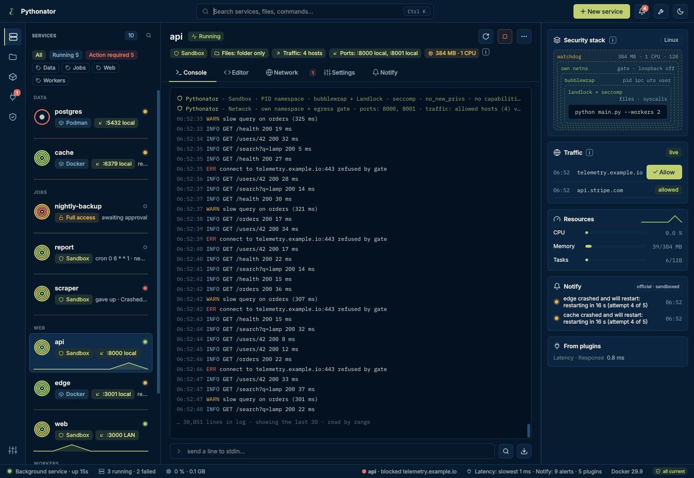
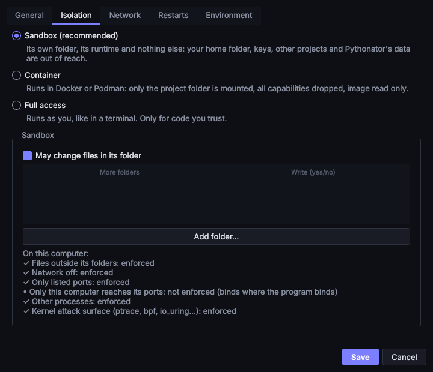
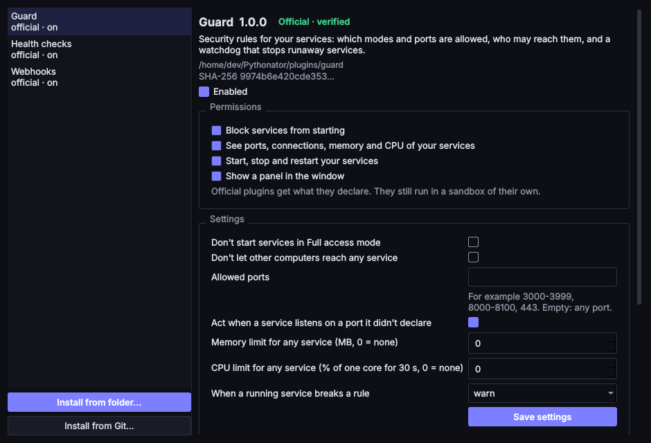
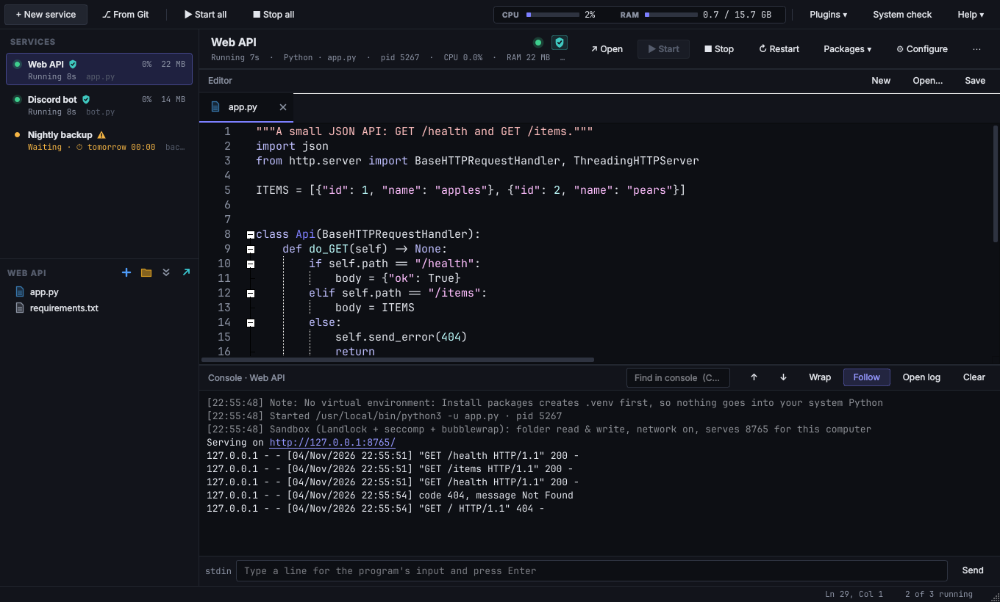
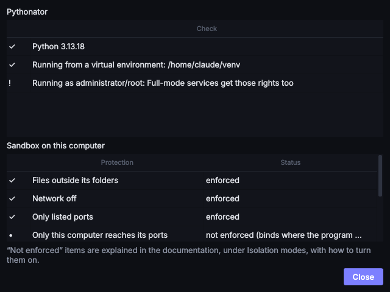
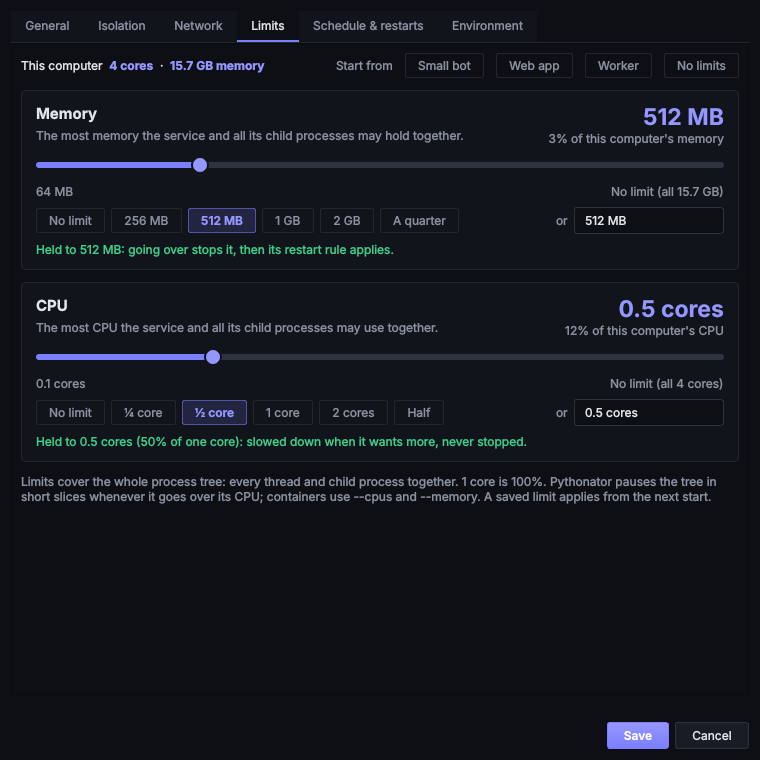
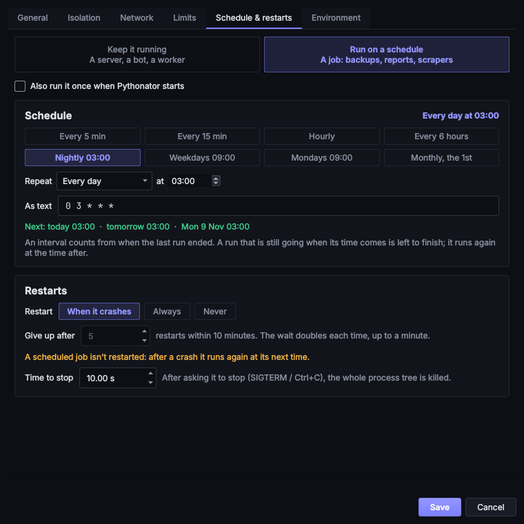

<p align="center">
  
</p>

<h1 align="center">Pythonator</h1>

<p align="center">
  A desktop supervisor for long-running programs: bots, web servers, workers and scheduled jobs, each in its own sandbox.<br>
  <a href="https://cfunkz.github.io/Pythonator/">Website</a> ·
  <a href="https://cfunkz.github.io/Pythonator/docs/">Documentation</a> ·
  <a href="https://cfunkz.github.io/Pythonator/docs/faq.html">FAQ</a> ·
  <a href="CHANGELOG.md">Changelog</a>
</p>

<p align="center">
  
</p>

Pythonator runs programs that are meant to stay up, such as a Discord bot, a FastAPI or Express server, or a
scraper on a timer. Each program is a *service*: Pythonator starts it, restarts it after a crash, records its output
and keeps it to its own folder (Sandbox and Container modes) and, where the system allows it, the ports it declares. Services are run by a background process, so they keep
going after the window is closed. It runs on Windows, macOS and Linux.

* **Supervision.** Restarts with exponential back-off, interval and [cron](https://man7.org/linux/man-pages/man5/crontab.5.html)
  schedules, memory and CPU limits for the whole process tree, live CPU, memory and port figures, and rotating logs
  with secrets masked. See [Services](docs/services.md).
* **Isolation.** Sandbox mode (the default) uses the operating system's own mechanisms:
  [Landlock](https://docs.kernel.org/userspace-api/landlock.html), [seccomp](https://man7.org/linux/man-pages/man2/seccomp.2.html)
  and [bubblewrap](https://github.com/containers/bubblewrap) on Linux, Seatbelt on macOS, and
  [AppContainer](https://learn.microsoft.com/en-us/windows/win32/secauthz/appcontainer-isolation) with a
  [job object](https://learn.microsoft.com/en-us/windows/win32/procthread/job-objects) on Windows. Container mode uses
  Docker or Podman with a hardened set of flags. Full access needs confirmation. See [Isolation modes](docs/isolation.md).
* **Networking.** Each service lists the ports it may listen on and whether other computers may connect. On Windows,
  **Make reachable** adds the loopback exemption and firewall rules for that one service. See
  [Ports and APIs](docs/networking.md).
* **Plugins.** Plugins run as separate sandboxed processes. Official plugins are verified by SHA-256; third-party
  plugins start in test mode with no permissions. Notify (alerts, webhooks and health checks), Guard, Project builder
  and an AI assistant are bundled. See [Plugins](docs/plugins.md).
* **Languages.** Python (with a per-project `.venv`), Node.js, Bun, Deno, Go, Rust, Java, .NET, Ruby, PHP, shell,
  PowerShell, or any command. Package installs run under the same isolation as the service. See
  [Languages](docs/languages.md).
* **Editor.** Built on [QScintilla](https://www.riverbankcomputing.com/software/qscintilla/): highlighting, folding,
  multiple carets, and large files without lag.
* **Git.** Clone with hooks and submodules disabled; pull is fast-forward only. See [Git](docs/git.md).

<table>
  <tr>
    <td></td>
    <td></td>
  </tr>
  <tr>
    <td></td>
    <td></td>
  </tr>
  <tr>
    <td></td>
    <td></td>
  </tr>
</table>

More screenshots, one for each tab and plugin, are in the [documentation](docs/README.md).

## Installation

Installers are on the [Releases](https://github.com/cfunkz/Pythonator/releases) page: `setup.exe` for Windows, `.dmg`
for macOS (Apple silicon and Intel), `.deb` for Ubuntu, Debian and Raspberry Pi OS, and portable `.zip` and `.tar.gz`
archives. Each release includes `SHA256SUMS.txt` and signed build provenance.

To run from source (Python 3.12 or later):

```bash
git clone https://github.com/cfunkz/Pythonator.git
cd Pythonator
python -m venv .venv
. .venv/bin/activate                       # Windows: .venv\Scripts\activate
pip install --require-hashes -r requirements.lock
pip install --no-deps -e .
pythonator
```

[Getting started](docs/getting-started.md) covers the first service.

## Documentation

| Topic | Pages |
| --- | --- |
| Using Pythonator | [Getting started](docs/getting-started.md) · [Services](docs/services.md) · [Isolation modes](docs/isolation.md) · [Ports and APIs](docs/networking.md) · [Languages](docs/languages.md) · [Git](docs/git.md) · [Plugins](docs/plugins.md) · [FAQ](docs/faq.md) |
| Extending it | [Writing a plugin](docs/plugin-development.md) · [Plugin API](docs/plugin-api.md) · [Background service API](docs/service-api.md) · [Adding a language](docs/adding-a-language.md) · [Architecture](docs/architecture.md) |
| Security | [Security model](docs/security.md) · [Reporting a vulnerability](SECURITY.md) |
| Contributing | [Development and CI](docs/development.md) |

The same pages are published, with navigation, on the [website](https://cfunkz.github.io/Pythonator/docs/).

## Support

* Questions: [Discussions](https://github.com/cfunkz/Pythonator/discussions)
* Bugs and feature requests: [Issues](https://github.com/cfunkz/Pythonator/issues)
* Contact: [hello@routezero.tech](mailto:hello@routezero.tech)
* Donations: [Ko-fi](https://ko-fi.com/cfunkz81112)

**Help ▾ → About Pythonator** shows the credits and the version details to include in a bug report.

## Security

Security problems should be reported privately through
[GitHub security advisories](https://github.com/cfunkz/Pythonator/security/advisories/new), not in public issues.
See [SECURITY.md](SECURITY.md).

## Licence

[GPL-3.0](LICENSE). **Help ▾ → Licensing** lists the licence of Pythonator and of every library it uses.

---

<sub>Pythonator is designed and maintained by [cfunkz](https://github.com/cfunkz) as a solo project. AI-assisted
tooling (Claude Code) was used during development. Every release is built, installed and started in CI on Windows,
macOS and Linux before it is published.</sub>
