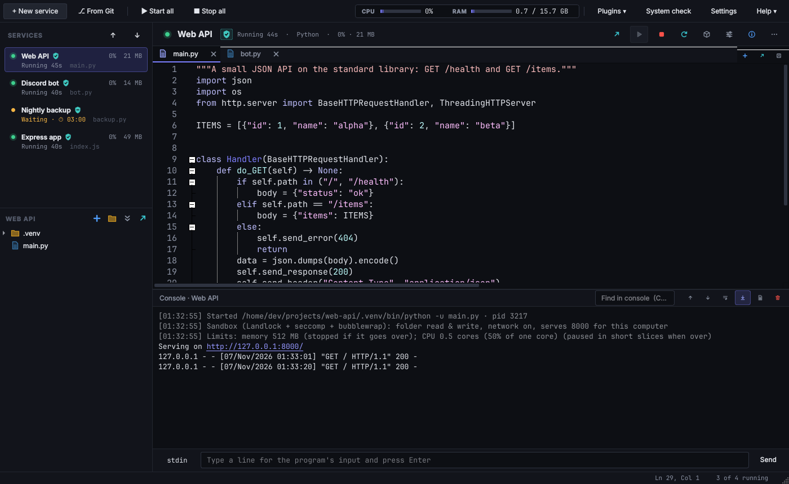
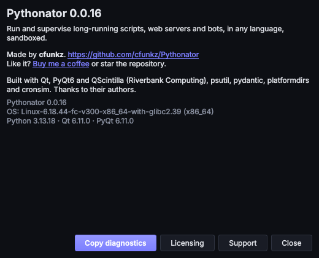

# Pythonator documentation

Pythonator supervises long-running programs: Discord and Telegram bots, web APIs, workers, scrapers and scheduled
jobs. Each program is a **service**. Pythonator starts it, restarts it when it fails, shows and logs its output,
restricts it to the files and ports it needs, and keeps it running after the window is closed. It includes a code
editor, and **plugins** add alerts, security rules, health checks and other features.

Pythonator runs on Windows, macOS and Linux, and supports Python, Node.js, Bun, Deno, Go, Java, .NET, Ruby, PHP,
Rust, shell scripts, PowerShell and arbitrary commands.

## Using Pythonator

| Page | Contents |
| --- | --- |
| [Getting started](getting-started.md) | Installation, a first service, the data folder, keyboard shortcuts |
| [Services](services.md) | Restarts, schedules, memory and CPU limits, environment variables, the console and logs |
| [Isolation modes](isolation.md) | Sandbox, Container and Full access: what each allows and how it is enforced |
| [Ports and APIs](networking.md) | Making a server reachable from the same computer or the local network; connecting to containers |
| [Languages](languages.md) | How each runtime is found, started and given its packages |
| [Git](git.md) | Cloning a repository as a service and pulling updates |
| [Plugins](plugins.md) | Official and third-party plugins, permissions, test mode, and the bundled plugins |
| [FAQ](faq.md) | Common questions and problems |

## Extending Pythonator

| Page | Contents |
| --- | --- |
| [Writing a plugin](plugin-development.md) | A tutorial: a minimal plugin, settings, a panel, and a policy plugin |
| [Plugin API](plugin-api.md) | Reference for `plugin.toml`, the Python SDK, permissions, panels and the message protocol |
| [Background service API](service-api.md) | The local socket protocol used by the window, for scripts and other tools |
| [Adding a language](adding-a-language.md) | For forks and pull requests: adding a runtime, and where other changes belong |
| [Architecture](architecture.md) | Processes, threads, files, and the reasoning behind the design |

## Security and the project

| Page | Contents |
| --- | --- |
| [Security](security.md) | The threat model, enforcement on each operating system, and known limitations |
| [Glossary](glossary.md) | Technical terms used in this documentation |
| [Development and CI](development.md) | Tests, checks, the official plugin catalogue, releases and this website |
| [Changelog](../CHANGELOG.md) | Changes in each version |

In the app, the **Help ▾** menu opens this documentation (**Documentation**), links for questions, bug reports and
private security reports (**Support**), the licences of Pythonator and its dependencies (**Licensing**), and the
credits and version details (**About Pythonator**).

