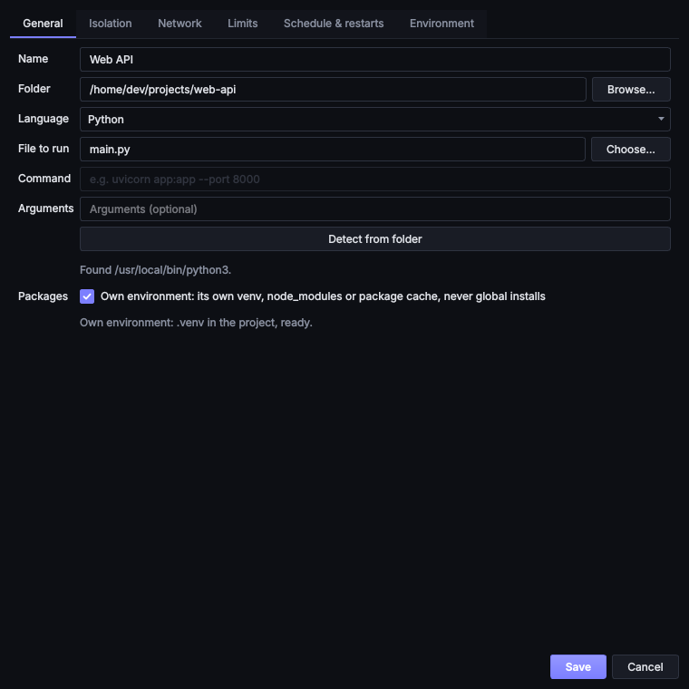
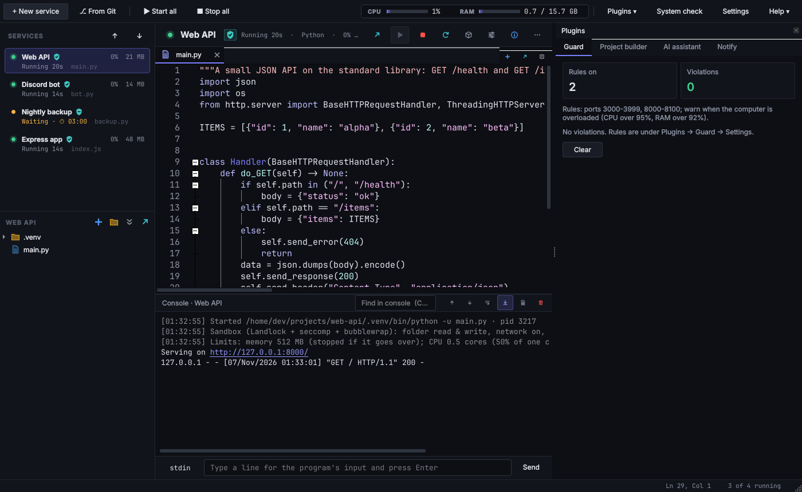
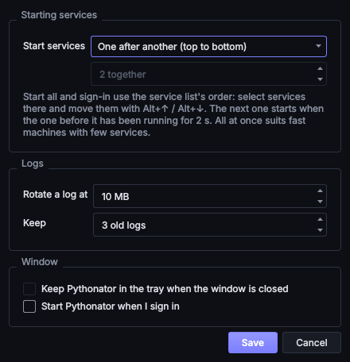

# Getting started

## Installation

### From a release

Download the file for the system from the [latest release](https://github.com/cfunkz/Pythonator/releases/latest):

| System | File |
| --- | --- |
| Windows 10 and 11 | `Pythonator-<version>-windows-x64-setup.exe` (installer) or the portable `.zip` |
| macOS | `Pythonator-<version>-macos-arm64.dmg` (Apple silicon) or `-macos-x86_64.dmg` (Intel); drag the app to Applications |
| Ubuntu, Debian, Mint | `pythonator_<version>_amd64.deb`, installed with `sudo apt install ./pythonator_<version>_amd64.deb` |
| Raspberry Pi OS, other ARM Linux | `pythonator_<version>_arm64.deb` |
| Other Linux | `Pythonator-<version>-linux-<arch>.tar.gz`; unpack it and run `Pythonator/Pythonator` |

The builds are not code-signed. On Windows, SmartScreen may show "Windows protected your PC": choose **More info**,
then **Run anyway**. On macOS, open the app once, then allow it under **System Settings → Privacy & Security → Open
Anyway**.

An update installs over the previous version and stops the background service first. Uninstalling (on Windows,
through **Settings → Apps**) also removes the sandbox entries from folder permissions. Settings and logs are kept.

### From source

Python 3.12 or later is required. `requirements.lock` pins every dependency, direct and indirect, with its SHA-256
hash, so the installed versions are exactly the ones that were tested and audited
([pip secure installs](https://pip.pypa.io/en/stable/topics/secure-installs/)):

```bash
git clone https://github.com/cfunkz/Pythonator.git
cd Pythonator
python -m venv .venv
. .venv/bin/activate            # Windows: .venv\Scripts\activate
pip install --require-hashes -r requirements.lock
pip install --no-deps -e .
pythonator
```

`pip install -e .` alone also works, but resolves the newest versions allowed by `pyproject.toml`.

On Linux, installing [bubblewrap](https://github.com/containers/bubblewrap) (`sudo apt install bubblewrap` or
`sudo dnf install bubblewrap`) gives the strongest sandbox. Without it the sandbox still applies Landlock and seccomp,
which current kernels provide. **System check** in the toolbar shows what the computer enforces.

## A first service

1. Choose **+ New service** (<kbd>Ctrl</kbd>+<kbd>N</kbd>), drop a script or folder onto the window, or choose
   **⎇ From Git** to clone a repository.
2. Set the **Folder** of the project. **Detect from folder** selects the language and the file to run (`main.py`,
   `index.js`, `main.go`, a `package.json`, `go.mod`, `Cargo.toml` and so on).
3. Leave the mode on **Sandbox**. For a server, open the **Network** tab and list its port, for example `8000`.
4. Choose **Save**. If the project has dependencies (`requirements.txt`, `package.json`, `Gemfile`, …), run
   **Packages ▾ → Install packages**. Then choose **Start** (<kbd>F5</kbd>).



The console shows the program's output as it arrives. The first line states what the sandbox allows, for example:

```text
[19:05:20] Sandbox (Landlock + seccomp + bubblewrap): folder read & write, network on, serves 8000 for this computer
```

The service keeps running when the window is closed; reopening Pythonator shows it again.

## The window



| Area | Position | Contents |
| --- | --- | --- |
| Services | Top left | Each service with its state, isolation mode, what it runs, and CPU and memory use while running. Right-click for more actions |
| Files | Below the services | The selected service's folder. Double-click a file to open it |
| Editor | Centre | Open files, with highlighting for every supported language |
| Console | Below the editor | The program's output, and an input line for its standard input |
| Plugins | Right | One tab for each plugin that has a panel, such as Guard and Notify |

The dividers between the areas can be dragged.

## Closing and quitting

When the window is closed while services are running, Pythonator asks what to do:

* **Keep them running**: the background service carries on. Services with **Start when Pythonator starts** ticked
  start again whenever the background service starts.
* **Stop everything and quit**: every service is stopped (Ctrl+C or `SIGTERM`, then killed after its stop timeout)
  and the background service exits.

If nothing is running, closing the window quits Pythonator.

To start Pythonator at sign-in, tick **Start Pythonator when I sign in** (**Start Pythonator with Windows** on
Windows) under **Settings**. It then starts in the tray, or minimised.



## The data folder

| System | Folder |
| --- | --- |
| Windows | `%LOCALAPPDATA%\Pythonator` |
| macOS | `~/Library/Application Support/Pythonator` |
| Linux | `~/.local/share/Pythonator` |

The `PYTHONATOR_HOME` environment variable selects a different folder. Its contents:

| File or folder | Purpose |
| --- | --- |
| `services.json` | The services |
| `settings.json` | Settings, plugin settings and granted plugin permissions |
| `logs/` | One rotating log per service, and `daemon.log` |
| `sandbox/` | Each sandboxed service's private home and temporary folders |
| `plugins/`, `plugin-data/` | Installed third-party plugins, and each plugin's own data |
| `daemon.token`, `daemon.sock` | Authentication and the socket for the [background service API](service-api.md) |

The folder is readable only by the user's account. No service can access it except in Full access mode.

Services from the preview builds were stored in `pythonator.json`. The first start imports that file once; entries
that fail the current validation are skipped and listed.

## Keyboard shortcuts

| Keys | Action |
| --- | --- |
| <kbd>Ctrl</kbd>+<kbd>N</kbd> | New service |
| <kbd>Ctrl</kbd>+<kbd>E</kbd> | Configure the selected service |
| <kbd>F5</kbd> | Start the selected service |
| <kbd>Shift</kbd>+<kbd>F5</kbd> | Stop it |
| <kbd>Ctrl</kbd>+<kbd>R</kbd> | Restart it |
| <kbd>Alt</kbd>+<kbd>↑</kbd> / <kbd>Alt</kbd>+<kbd>↓</kbd> | Move the selected services up or down the list |
| <kbd>Ctrl</kbd>+<kbd>S</kbd> | Save the open file |
| <kbd>Ctrl</kbd>+<kbd>F</kbd> / <kbd>Ctrl</kbd>+<kbd>H</kbd> | Find / find and replace in the open file |
| <kbd>Ctrl</kbd>+<kbd>+</kbd> / <kbd>Ctrl</kbd>+<kbd>−</kbd> | Zoom the editor in or out (applies to all open files) |
| <kbd>Ctrl</kbd>+<kbd>W</kbd> | Close the open file |
| <kbd>Ctrl</kbd>+click | Add a caret |
| <kbd>Ctrl</kbd>+<kbd>\`</kbd> | Switch the console input between the program's stdin and a shell |

On macOS, <kbd>Ctrl</kbd> is <kbd>⌘</kbd>.

## Further reading

* [Services](services.md): restarts, schedules, limits and environment variables.
* [Isolation modes](isolation.md) and [Ports and APIs](networking.md): what a service can reach.
* [Plugins](plugins.md): alerts, rules and health checks.
