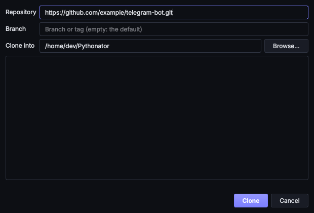

# Git

Pythonator can clone a repository as a new service and pull updates into it later. It uses the locally installed
`git`, with options that make it safe to use on unreviewed code.

## Cloning a repository

Choose **⎇ From Git**:

| Field | Meaning |
| --- | --- |
| Repository | `https://host/owner/repo.git`, `ssh://user@host/owner/repo` or `git@host:owner/repo.git` |
| Branch | A branch or tag; empty for the repository's default branch |
| Clone into | The parent folder; the repository gets its own folder inside it |

When the clone finishes, the new-service form opens with the folder, language and file to run filled in. Code that
has not been reviewed should start in Sandbox mode with the network off.

Private repositories use whatever authentication the local `git` already has: an SSH key, or a
[credential helper](https://git-scm.com/docs/gitcredentials) for HTTPS. Pythonator never asks for or stores a
password.

## Pulling updates

Select the service and choose **Packages ▾ → Pull from Git (fast-forward only)**, or tick **Pull the newest code
before every start (fast-forward only)** on its **Environment** tab.

A pull fetches, then [fast-forwards](https://git-scm.com/docs/git-merge#Documentation/git-merge.txt---ff-only)
(`git merge --ff-only`). It never merges, rebases or discards local work: if the checkout has commits or changes of
its own, the pull stops and says so, and the conflict is left to be resolved with git. The console shows the range of
commits applied, `old..new`.

## Hardening

| Measure | Reason |
| --- | --- |
| Only `https` and `ssh` | `file://`, `ext::` and other transports that can run commands are disabled ([`protocol.allow=never`](https://git-scm.com/docs/git-config#Documentation/git-config.txt-protocolallow)) |
| Addresses validated | An address may not start with `-` (no injected options) and must match one of the three forms above; `--` always separates options from the address |
| Hooks disabled | [`core.hooksPath`](https://git-scm.com/docs/githooks) points to an empty folder in Pythonator's private data folder, so a repository cannot run its own code on clone or pull |
| No submodules | `--no-recurse-submodules`, since a submodule could point anywhere |
| No fsmonitor | `core.fsmonitor=false`, so a repository's config cannot name a program to run |
| No prompts | `GIT_TERMINAL_PROMPT=0` and no interactive credential helper, so a background pull cannot hang on a password prompt |
| No system config | `GIT_CONFIG_NOSYSTEM=1` |
| The checkout's own config checked | A pull runs as the user, in a folder a sandboxed service can write to. Its `.git/config` may therefore hold only what git writes itself (remotes, branches, basic `core.*` keys, `user.name`). Anything else, such as `core.sshCommand`, a filter driver, `credential.helper` or `include.path`, stops the pull and is named. Such settings belong in `~/.gitconfig` |
| Nothing runs during a pull | The service must be stopped first unless it has Full access, and so must every other service whose folder is the same, inside or around it, with its installs and console commands. Pull on start skips the pull, and says so, while another such service runs. Nothing sandboxed starts in that folder until the pull is done, so nothing can change the checkout while git works in it |
| Sign-in programs pinned | `credential.helper` and `core.sshCommand` are set on git's command line to what `~/.gitconfig` says, and `core.askPass` to nothing, so the checkout's config can't add one. The config is checked again after the fetch, before the merge |

The clone itself runs as the user, as git always does. The cloned code does not run until the service is started, in
the chosen mode.
