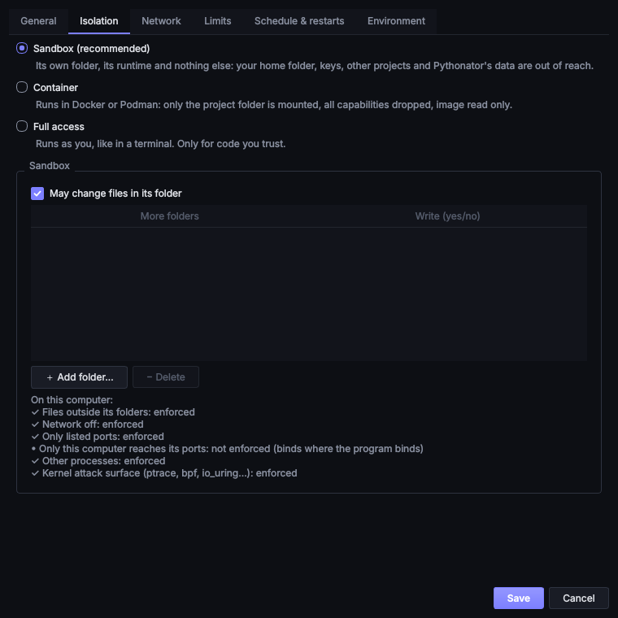

# Isolation modes

Every service runs in one of three modes (four on Windows), set on its **Isolation** tab. New services default to
**Sandbox**; the `default_mode` key in `settings.json` changes this.

| Mode | What the program can reach | Requirements |
| --- | --- | --- |
| **Sandbox** | Its project folder, its runtime's files, and the network only if enabled, on the listed ports | None: built into Windows, macOS and Linux |
| **Container** | Only the project folder, mounted at `/app` inside a container image | Docker or Podman |
| **Full access** | Everything the user's account can read, change and connect to | Trust in the code |
| **WSL** (Windows) | Linux in a WSL 2 distribution as the user's Linux account, and the Windows files under `/mnt` | WSL 2, and trust in the code |

One rule applies in every mode: **if a protection cannot be applied, the service does not start.** It never runs
with less than its mode promises. The first console line of each start states exactly what was applied.

## Sandbox

The sandbox is built from mechanisms the operating system already provides. It needs no administrator rights and no
additional software.



A sandboxed service **can**:

* read its project folder and change files in it (untick **May change files in its folder** to make it read-only);
* read its runtime's installation (the Python, Node.js or Java it runs with, and the project's `.venv`);
* use a private home and temporary folder, kept in Pythonator's data folder;
* use the network when **May use the network** is ticked, listening only on the listed ports;
* use any **More folders** added to it, read-only or read-write.

It **cannot**:

* read the user's home folder, documents, other projects, SSH and cloud credentials, browser profiles, or
  Pythonator's own data (the token, logs, and other services' sandboxes);
* write anywhere else, including system folders;
* listen on an unlisted port, or use the network at all when it is disabled;
* see or signal other programs, or attach a debugger to them;
* reach the desktop session: the display, clipboard, D-Bus, SSH agent and keyring are not passed in.

**More folders** cannot be the whole home folder, a whole drive, Pythonator's data folder, a folder of keys or
credentials (`.ssh`, `.gnupg`, `.aws`, `.kube`, `.docker`, `.netrc`, …), or a folder that contains one (such as
`~/.config`, which holds the `gh` and `gcloud` credentials). Pythonator refuses these and gives the reason.

### Enforcement on each system

| System | Files | Network | Processes |
| --- | --- | --- | --- |
| Linux | [Landlock](https://docs.kernel.org/userspace-api/landlock.html) rules on the folders above; [bubblewrap](https://github.com/containers/bubblewrap), when installed, also gives the service its own view of the file system | Landlock TCP rules allow only the listed ports and a system-chosen port (Linux 6.7+); [seccomp](https://man7.org/linux/man-pages/man2/seccomp.2.html) removes sockets entirely when the network is off | New PID, IPC and user namespaces under bubblewrap; Landlock scoping and seccomp block `ptrace`, `bpf`, `io_uring` and other kernel attack surface |
| macOS | A [Seatbelt](glossary.md#seatbelt) profile that denies everything, then allows the folders above | Outbound connections, and listening only on the listed ports, on `127.0.0.1` unless other computers are allowed | Cannot signal or inspect processes outside its own |
| Windows | An [AppContainer](https://learn.microsoft.com/en-us/windows/win32/secauthz/appcontainer-isolation) per service; Pythonator grants it its folders and records each grant so that removing the service revokes them | Network capabilities only when the network is on; inbound connections need [Make reachable](networking.md#windows-make-reachable) | A [job object](https://learn.microsoft.com/en-us/windows/win32/procthread/job-objects) holds the whole process tree, so nothing outlives a stop |

**System check** lists each protection and whether the computer enforces it. On Linux, *Only this computer reaches
its ports* shows **not enforced**: Landlock restricts ports but not addresses, so a program given `HOST=127.0.0.1`
can still bind `0.0.0.0`. Use a firewall, or Container mode, where this matters.

### When the sandbox cannot start

If the sandbox cannot be set up (an old kernel without Landlock, a locked-down macOS, a Windows edition without
AppContainers), the service shows **failed** with the reason and nothing runs. Pythonator never falls back to running
it unsandboxed. Container mode, or Full access for trusted code, are the alternatives.

### Windows: runtimes installed for all users

A sandboxed service runs its runtime (Python, Node.js, npm, …) from where it is installed, so the sandbox must be
able to read that folder. Windows lets every AppContainer read `C:\Program Files`, but some installers, including
Node.js's, create their folder without the `ALL APPLICATION PACKAGES` entry, and only an administrator can add it.

* **Node.js** needs no action. Pythonator copies node.exe and npm (about 100 MB) once per Node.js version into its
  data folder (`runtimes\node-…`), and the sandbox reads and runs that copy without being able to write to it. The
  copy is also used wherever Node.js is installed, for the reason given in
  [Node.js programs that start other programs](#windows-nodejs-programs-that-start-other-programs). npm and npx run as
  `node.exe npm-cli.js`, without a batch file. **System check** reports when the copy is in use. A new Node.js version
  gets a new copy and the old one is removed.
* **Other runtimes** (Python, Go, Java, … installed for all users without that entry) are refused before the start,
  with the fix, rather than failing with *Access is denied*. **System check** marks them and offers **Let sandboxes
  use it…**, a single administrator prompt that lets every sandbox read and execute (never modify) that folder, as
  Windows already allows for `C:\Program Files`. The equivalent command in an administrator terminal uses
  [icacls](https://learn.microsoft.com/en-us/windows-server/administration/windows-commands/icacls) with the
  well-known SID for all application packages:

```
icacls "C:\Program Files\Python313" /grant "*S-1-15-2-1:(OI)(CI)(RX)"
```

A runtime installed for the current user only (for example Node.js through nvm-windows or fnm, or Python from
python.org installed "for me only") needs nothing: Pythonator grants the sandbox access itself.

### Windows: Node.js and the folders above the sandbox

A sandbox may use its own folders but may not inspect the folders above them (`C:\`, `C:\Users`, the profile folder).
Node.js and npm resolve every path component on the way to a file (`realpath`), and so failed with
*EPERM: operation not permitted, lstat 'C:\'*. Every Node.js process in a sandbox, including those started by npm,
therefore starts with:

* [`--preserve-symlinks --preserve-symlinks-main`](https://nodejs.org/api/cli.html#--preserve-symlinks): modules are
  loaded by the path at which they were found, without the walk. A package linked from elsewhere (`npm link`, pnpm's
  layout) is then loaded from the link's location.
* a small preload, `pythonator-node.cjs` in the sandbox's own folder. When a lookup of a folder *above* the sandbox's
  folders is refused, it reports a directory, with no name, size or timestamp. A refused `realpath` falls back to
  Windows' own; if that is also refused (it needs the drive name, which a sandbox may not query), the answer is the
  absolute path itself, once the file is confirmed to exist. This matches what `--preserve-symlinks` already does for
  modules, and grants no access.

Both are passed through [`NODE_OPTIONS`](https://nodejs.org/api/cli.html#node_optionsoptions); a service's own
`NODE_OPTIONS` are kept and appended.

### Windows: Node.js programs that start other programs

When a Node.js program starts a child process (Vite at start-up, Next.js and Angular for their workers, npm for
install scripts), Node.js creates pipes for the child's input and output. Its I/O library,
[libuv](https://github.com/libuv/libuv), names them `\\?\pipe\uv\…`, but an AppContainer may only create pipes under
`\\?\pipe\LOCAL\…`. libuv treats the refusal as a name collision and retries indefinitely, so Node.js uses a whole
core and prints nothing. libuv 1.53 fixes this, but no Node.js release includes it yet (November 2026).

Until one does, sandboxes run Pythonator's private copy of Node.js (see above) for any Node.js with the old pipe
names. In the copy's `node.exe`, Pythonator replaces that one format string, `\\?\pipe\uv\%llu-%lu`, with
`\\?\pipe\LOCAL\%llu` (the same length, and the prefix libuv 1.53 uses in an AppContainer), and changes nothing else.
The installed Node.js is not modified. Because the patched binary no longer matches its signature, the copy is
unsigned, as a locally built program would be. Full access and containers use the installed Node.js unchanged.

## Container

Container mode runs the service with **Docker** or **Podman** (Podman is preferred on Linux, as it needs no root
daemon). The project folder is mounted at `/app` and is the working directory.

Every container starts with these [`run`](https://docs.docker.com/reference/cli/docker/container/run/) flags
([Podman equivalent](https://docs.podman.io/en/latest/markdown/podman-run.1.html)):

| Flag | Purpose |
| --- | --- |
| `--cap-drop ALL` | No Linux capabilities: it cannot reconfigure the network, mount file systems or load modules |
| `--security-opt no-new-privileges` | `setuid` programs inside cannot gain privileges |
| `--read-only`, with a small `/tmp` and home | The image cannot be modified; only the project folder can |
| `--pids-limit 1024` | Stops a fork bomb at 1,024 processes |
| `--network none` | When the network is off |
| `-p 127.0.0.1:PORT:PORT` | Publishes its ports to this computer only, or `-p PORT:PORT` for other computers too |
| `--user` with the user's ID (Docker) or `--userns keep-id` (Podman) | Files written to the project belong to the user |
| `--memory`, `--cpus` | When a memory or CPU limit is set |

Pythonator never adds `--privileged`, `--cap-add`, `--device`, `--network host` or extra mounts. Variables reach the
container through the engine's environment (`-e NAME`), so their values do not appear in a process list. An env file
in the project cannot set the engine's own variables (`DOCKER_*`, `PATH`, `HOME`, `XDG_*`), since these would change
which engine, or which program, the local CLI talks to.

The **image** defaults to the language's official slim image (`python:3.13-slim`, `node:24-slim`, `golang:1.27`, …)
and can be any named image, optionally pinned by digest (`python:3.13-slim@sha256:…`). For Python, Install packages
creates `/app/.venv-container`, which the container then uses, so it does not conflict with a `.venv` made for the
host.

**Docker inside WSL** (Windows): the engine `wsl` runs the container with Docker Engine installed inside a WSL 2
distribution (the one on the Isolation tab's WSL box, or WSL's default), for computers without Docker Desktop. Docker
Desktop's own WSL 2 backend needs nothing extra: that is the `docker` engine. With `wsl`, Pythonator runs
`wsl.exe --distribution <name> --exec docker run …` with the same flags as above. It mounts the folder as WSL sees it
(`/mnt/c/…`, found with [`wslpath`](https://learn.microsoft.com/en-us/windows/wsl/filesystems)), runs as the Linux
user who owns it there (`--user`), and passes variables through
[`WSLENV`](https://devblogs.microsoft.com/commandline/share-environment-vars-between-wsl-and-windows/). Ports published
to `127.0.0.1` reach Windows through WSL's localhost forwarding. Other computers reach them only with WSL's mirrored
networking. Compose projects need Docker Desktop. `auto` never chooses `wsl`, since asking would start WSL.

To reach another container, such as a database, see
[Connecting to other containers](networking.md#connecting-to-other-containers).

### Docker Compose projects

A folder with a `compose.yaml` (or `compose.yml`, `docker-compose.yml`) can be run as one service by choosing
**Docker Compose** as the language, in Container mode. **Start** runs `docker compose up` and shows every
container's output in the console, **Stop** runs `docker compose stop`, and the **Compose ▾** menu builds, pulls,
lists (`ps`) and removes the project (`down`, after confirmation). The project is named `pythonator-<id>`, so its
containers, networks and volumes never mix with another project's. The Environment table and env file supply the
file's `${VARIABLES}`.

A Compose file can request far more than Pythonator's own containers get. Before each start and build, Pythonator
resolves it as the engine does ([`docker compose config`](https://docs.docker.com/reference/cli/docker/compose/config/),
Compose 2.24 or newer) and refuses it, with the reason, if it requests:

* `privileged`, a host or another container's namespace (`network_mode: host`, `pid: host`, …), devices, powerful
  capabilities (`SYS_ADMIN`, `NET_ADMIN`, …), or `security_opt` that disables a protection;
* a bind mount, build context, env file, secret or config outside the project folder, or the engine's socket,
  including a named volume that is a bind mount in disguise (`driver_opts: {o: bind, device: /…}`);
* the host network, including by name (`networks: {x: {name: host, external: true}}`);
* a port published on all interfaces while the service is limited to this computer (use `127.0.0.1:8000:8000`, or
  allow other computers on the Network tab).

If the check cannot run, nothing starts. The console's shell mode is not available for Compose projects; use
`docker compose exec` in a terminal. A file that genuinely needs more can run as a Custom command in Full access mode.

## Full access

Full access runs the program as the user, as a terminal would. It can read the user's files and keys, install
software and connect anywhere. Pythonator asks for confirmation before the first start of each Full access service
and shows the mode in red. The program still runs in its own process group (a job object on Windows), so stopping it
ends everything it started.

It is intended for trusted tools that need the desktop or the whole disk.

## WSL (Windows)

WSL mode runs the service in a [WSL 2](https://learn.microsoft.com/en-us/windows/wsl/) Linux distribution with
Linux's own runtimes, for projects that need Linux (uvloop, gunicorn, shell scripts, Linux-only packages). It is
**not a sandbox**: the program runs as the distribution's user, who can change the Windows files under `/mnt` and
everything in the Linux home. Like Full access, it asks for confirmation before the first start, and the
[Guard](plugins.md#guard) plugin's "no Full access" rule blocks it too. For isolation on Linux, use Container mode with
the `wsl` engine.

Pythonator starts it with Microsoft's `wsl.exe` from `System32`: `wsl.exe --distribution <name> --cd <folder> --exec
/bin/sh -lc 'exec "$0" "$@"' <program> …`. The login shell gives the PATH of `~/.profile` (`~/.local/bin`, Cargo, Go).
Version managers that only set themselves up in `~/.bashrc`, such as nvm, need their program's full path as a Custom
command. Variables from the service and its env file reach Linux through `WSLENV`, never on a command line. Nothing
else of the Windows environment does.

* **Packages:** Packages ▾ → Install packages runs WSL's runtime in the project. Python gets `.venv-wsl` (made with
  `python3 -m venv`, so Ubuntu and Debian need `python3-venv`), next to any Windows `.venv`. Node.js uses the project's
  `node_modules`, which native modules built on Windows do not share.
* **Stop:** every process of a run carries a mark (`PYTHONATOR_WSL_RUN`). Stop sends `SIGTERM` to each process with it
  inside Linux, and `SIGKILL` after the grace period. This also ends processes that left the run's session, which
  ending `wsl.exe` alone is not documented to do.
* **Ports:** `PORT` and `HOST` are set as in other modes. WSL's localhost forwarding makes a server reachable at
  `127.0.0.1` on Windows. Other computers reach it only with WSL's
  [mirrored networking](https://learn.microsoft.com/en-us/windows/wsl/networking).
* **Not available:** RAM and CPU limits for one service (`.wslconfig` limits all of WSL) and turning the network
  off. A start with either set is refused, not run without it.
* **Speed:** files under `/mnt/c` are slower for Linux than its own disk. A project in the distribution
  (`\\wsl.localhost\<name>\home\…`) can be chosen as the folder instead.

## Choosing a mode

| Situation | Suggested mode |
| --- | --- |
| A bot or API under development | Sandbox, network on, port listed |
| Newly cloned code that has not been reviewed | Sandbox with the network off at first, or Container |
| A service that needs a database or other containers | Container, on their network |
| A tool that must control the desktop or reach every folder | Full access, if trusted |
| Trusted code that needs Linux, on Windows | WSL, or Container with the `wsl` engine for isolation |

The [Guard](plugins.md#guard) plugin can enforce policies of this kind across all services, for example *no Full
access* or *only ports 8000–8100*.
