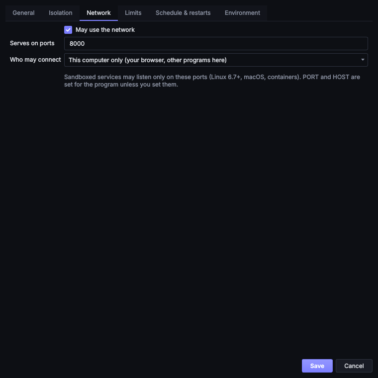

# Ports and APIs

A web server, API or webhook receiver needs a port that other programs can connect to. Pythonator lets a service
listen only on the ports it lists, and controls who may connect.

## Serving a port

The service's **Network** tab:

| Setting | Meaning |
| --- | --- |
| May use the network | Off: no network at all, not even outbound connections. On: outbound connections allowed |
| Serves on ports | The ports it listens on, for example `8000` or `8000, 8443` (up to 32) |
| Who may connect | **This computer only**: the browser and other programs on this computer. **Other computers on home or work networks too**: other devices on the local network |



Unless the service sets them itself, Pythonator passes the first port to the program as `PORT` and, for *This
computer only*, `HOST=127.0.0.1`. Most frameworks read these variables; otherwise:

```python
# Python (FastAPI with uvicorn)
import os, uvicorn
uvicorn.run("app:app", host=os.environ.get("HOST", "127.0.0.1"), port=int(os.environ["PORT"]))
```

```js
// Node.js (Express)
app.listen(Number(process.env.PORT), process.env.HOST ?? "127.0.0.1");
```

```go
// Go
http.ListenAndServe(os.Getenv("HOST")+":"+os.Getenv("PORT"), mux)
```

While the service runs, the header shows a link to `http://127.0.0.1:PORT/` and the ports it actually listens on.
The [Notify](plugins.md#notify) plugin can poll a health-check path and report whether it answers.

## Enforcement by mode

| | Sandbox: Linux | Sandbox: macOS | Sandbox: Windows | Container |
| --- | --- | --- | --- | --- |
| Only the listed ports | Yes, on Linux 6.7+ ([Landlock](https://docs.kernel.org/userspace-api/landlock.html) TCP rules) | Yes | Yes, through the firewall rules added by Make reachable | Yes: only those ports are published |
| This computer only | Left to the program: Pythonator sets `HOST=127.0.0.1` | Yes | Yes (firewall rule for `127.0.0.1`) | Yes (`-p 127.0.0.1:PORT:PORT`) |
| Network off | Yes (seccomp: no sockets) | Yes | Yes (no network capability) | Yes (`--network none`) |

On Linux, a sandboxed server open to other computers is also subject to the host firewall (`ufw`, `firewalld`).

## Windows: Make reachable

Windows blocks inbound connections to every AppContainer, including from the same computer, until an administrator
allows them. On Windows the Network tab therefore has **Make reachable…** and **Undo**. Make reachable asks for
administrator rights once, then:

1. adds a loopback exemption for the service's AppContainer (`CheckNetIsolation LoopbackExempt`,
   [documentation](https://learn.microsoft.com/en-us/previous-versions/windows/apps/hh780593(v=win.10))), so that
   programs on this computer can connect;
2. adds a [Windows Filtering Platform](https://learn.microsoft.com/en-us/windows/win32/fwp/windows-filtering-platform-start-page)
   permit with the same scope (this AppContainer, loopback connections from `127.0.0.1`, the listed ports). Windows'
   built-in block on loopback connections *into* an AppContainer sits below the layer that firewall rules can
   override, and the loopback exemption alone only allows the container to connect *out*. The permit sits just above
   that block, for this one AppContainer, and stays until Undo. It is what allows a browser to open
   `http://127.0.0.1:<port>/`;
3. adds an inbound firewall rule for this service only, for TCP from `127.0.0.1` on the listed ports;
4. if *Other computers* is chosen, adds a second rule for the listed ports on private and domain networks (never on
   public networks).

Every rule is tied to the service's own AppContainer and placed in a **Pythonator** firewall group, so no other
program gains anything. **Undo** removes the exemption, the permit and both rules. **Removing** the service does the
same: if it was made reachable, Windows asks for administrator rights once more. If that prompt is cancelled (or the
service was removed with an older version), nothing listens behind the rules any more, but they remain in the
firewall and would admit whatever later runs under that AppContainer name. **System check** lists them under *Left
behind by services*, and **Clean up…** removes them.

Make reachable must be run again after the ports change. Without it the service runs and listens, but connections
time out.

A sandboxed server's start reports when Windows still blocks it, and the **Open** button (open in the browser) offers
Make reachable first, then opens the page, with the same single administrator prompt. Pythonator reads the exemption
list with `CheckNetIsolation LoopbackExempt -s`, which needs no administrator rights.

## Connecting to other containers

A service in Container mode can join a container network to reach a database or cache in another container by name.

1. Create a network and start the database on it, once:

   ```bash
   docker network create appnet
   docker run -d --name db --network appnet -e POSTGRES_PASSWORD=change-me postgres:17
   ```

2. On the service's **Isolation** tab, choose **Container** and enter `appnet` under **Network**.
3. In the program, connect to `db:5432`. Keep the password in the service's environment or `.env` file.

Any network name is accepted except `host`, which Pythonator refuses because it would remove the isolation.

Inside the container the program should listen on `0.0.0.0`. The engine publishes the port to the host on
`127.0.0.1` (this computer) or on all addresses (other computers), according to **Who may connect**.

## Connecting from a sandbox to a container

A sandboxed service with the network on can connect to a container's published port like any other program. For
example, a database started with `-p 127.0.0.1:5432:5432` is reachable at `127.0.0.1:5432`.

## Calling Pythonator itself

Pythonator's background service is not on the network. It listens on a local socket that only the user's account can
open, and requires a token. Scripts can use it through the [background service API](service-api.md).
