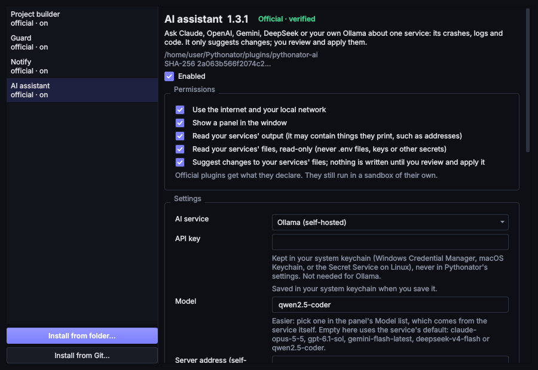
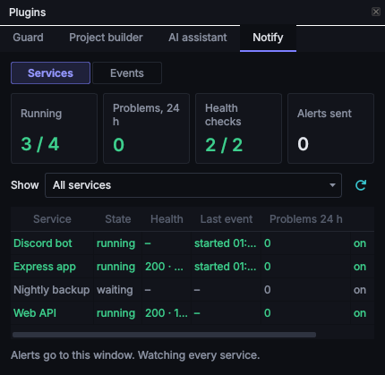
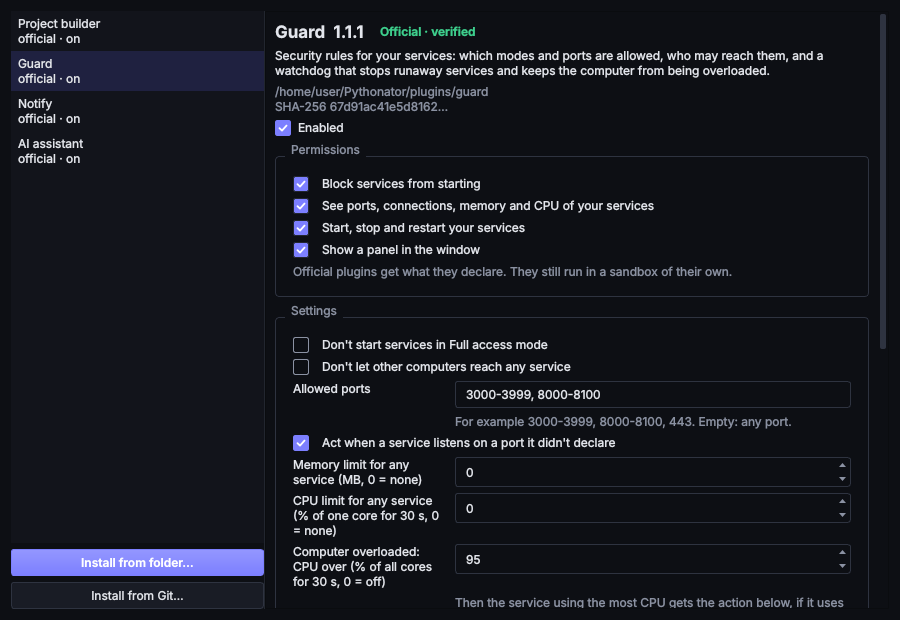
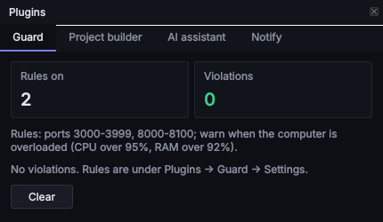
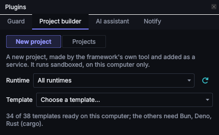
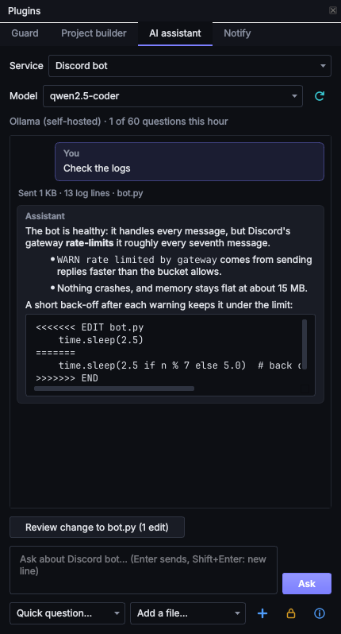

# Plugins

Plugins provide features that a service supervisor does not need built in: alerts, policy rules, health checks,
project templates, dashboards and integrations. Each plugin runs as a separate process in its own sandbox and talks
to Pythonator through a small, validated message protocol, so a plugin cannot crash Pythonator, freeze the window, or
do more than it has been granted.

**Plugins ▾ → Manage plugins…** in the toolbar opens the Plugins window, where plugins are enabled, configured and
granted permissions.

## Official and third-party plugins

| | Official | Third-party |
| --- | --- | --- |
| Source | The `plugins/` folder shipped with Pythonator | A folder or Git repository installed by the user |
| Recognised by | Files matching the SHA-256 hashes in the reviewed catalogue, [`official.json`](https://github.com/cfunkz/Pythonator/blob/main/pythonator/plugins/official.json) | Anything else, including an official plugin with a single byte changed |
| Permissions | Those declared in its manifest | **None** until granted individually |
| Test mode | No | **Yes**, until switched off: actions are recorded, not carried out |
| Sandbox | Yes | Yes |
| Badge | Official · verified | Third-party · sandboxed |

Before a third-party plugin runs for the first time, enabling it shows a warning with its name, source, SHA-256 and
requested permissions.

## Permissions

| Permission | Allows the plugin to |
| --- | --- |
| `network` | Use the internet and local network. Without it the plugin's sandbox has no network at all |
| `read_logs` | Receive the services' output, with secrets already masked |
| `inspect` | See the services' ports, connections, memory and CPU use, and the computer's totals |
| `control` | Start, stop and restart services |
| `policy` | Refuse a service's start, with a reason shown to the user |
| `ui` | Show a panel, as a tab in the Plugins dock |
| `read_files` | Read a service's files through Pythonator, read-only; never `.env` files, keys, certificates or other secrets |
| `propose_changes` | Suggest a change to a service's file. A review window opens, and only the user's **Apply** writes it |
| `create_services` | Create a project from one of Pythonator's built-in templates and add it as a service, and ask the user to delete such projects. The plugin chooses the template and name; Pythonator decides the command, folder and isolation (at most 10 per hour) |

Every plugin, whatever its grants, can see the list of services (name, language, mode, state, ports) and write to its
own Activity log. No plugin can read the user's files, Pythonator's data or other plugins' data, and without
`read_files` none can read the services' files either.

## Secrets in settings

A plugin setting of kind `secret` (an API key or token) is stored in the system keychain: Windows Credential Manager,
the macOS Keychain, or the [Secret Service](https://specifications.freedesktop.org/secret-service-spec/latest/)
(GNOME Keyring, KWallet) on Linux. `settings.json` only records that it exists, and the window only ever shows
`••••••`. Where there is no keychain (a Linux server without a desktop session), it is stored in `secrets.json` in
the data folder, readable only by the user, and the plugin's settings say so. Removing a plugin deletes its secrets.

## Test mode

Third-party plugins start in test mode. In test mode:

* the granted permissions still decide what the plugin receives;
* a start, stop or restart it requests is written to its **Activity** (*Test mode: would stop api*) instead of being
  carried out;
* a start it would refuse is recorded as *would block a start*, and the start proceeds.

Once its Activity shows the expected behaviour, untick **Test mode** and choose **Apply**. The plugin restarts with its
new permissions.

## Misbehaving plugins

Pythonator stops and disables a plugin, and records the reason, when it:

* sends more than 200 messages (or 2 MB) per second for a sustained period;
* sends a single message over 1 MB, or anything that is not a protocol message;
* crashes three times in ten minutes;
* stops reading its own input, leaving 2,000 messages unread.

A plugin that does not answer a start check within 2 seconds is skipped for that start. Panels are validated against
a fixed set of elements (text, numbers, tables, buttons, rows), at most 500 per panel, and displayed as plain text, so
a plugin cannot inject HTML, links or scripts into the window. A chat message may request Markdown (headings, lists,
code, links), which is rendered with HTML disabled and no remote content; links open in the browser only when clicked.

Changing a plugin's files on disk after it has been verified, removing it, or installing different code under the
same ID, clears its grants and live mode: it is treated as new, untrusted code.

## Plugin panels

Plugins with a panel show it as a tab in the **Plugins** dock (**Plugins ▾ → Show plugin panels**) on the right of
the window. The dock can be dragged to another edge. Panels adapt to the dock's width: rows of cards or buttons wrap,
and wide tables scroll horizontally.

## Installing a third-party plugin

In the Plugins window, choose **Install from folder…** (a folder containing a `plugin.toml`) or **Install from Git…**
(an `https` address). The plugin is copied into the data folder and stays disabled until enabled. **Remove plugin**
deletes it and its data. Official plugins can be disabled but not removed.

## Bundled plugins

### Notify

A single timeline for all services, with alerts for crashes, Pythonator giving up on restarts, blocked starts (by
Guard or another policy), failed installs, failing health checks, recoveries, and anomalies (steadily growing memory,
CPU stuck high, crash loops, bursts of error lines, a server's port disappearing). Notify replaced the Webhooks and
Health checks plugins in 0.0.11; their settings migrate automatically.

The panel has a **Services** view (each service with its state, health and last event) and an **Events** view. It
can filter by service or event kind, mute a service for a period, run a check immediately (**Check now**) and send a
test alert (**Send a test**).

| Setting | Meaning |
| --- | --- |
| Webhook URLs | One per line. Formatted for Discord, Slack, Telegram (`https://api.telegram.org/bot<token>/sendMessage?chat_id=<id>`), Microsoft Teams workflows and ntfy; any other `https` address receives JSON `{"title", "text", "source"}` |
| Only these services | Names, one per line; empty means all |
| Show alerts in Pythonator | A notice in the window, and a tray notification while the window is hidden |
| Alert when … | Which events alert: crashes, giving up, blocked starts, failed installs, recoveries, starts and stops, health checks, anomalies |
| Health check path, interval, timeout | `GET http://127.0.0.1:<port><path>` against each running service that serves a port |
| Anomaly thresholds | Memory growth in 10 minutes, CPU above a share of one core for 5 minutes, crashes in 10 minutes, error lines per minute (0 disables each) |
| Last output lines in a crash alert | How much output accompanies a crash alert |
| Seconds between webhook alerts for one service | Rate limit, so a crash loop produces a few messages rather than hundreds |

Permissions: `network`, `read_logs`, `inspect`, `ui`. Health checks only connect to this computer. Discord messages
cannot mention `@everyone`, whatever a service prints. Only `https` webhook addresses are used (plus `http` to this
computer), and redirects to plain HTTP are refused. A `429 Too Many Requests` response is retried after the delay the
server gives in `Retry-After`.

### Guard

Security rules for every service, checked before each start and monitored while services run.

| Setting | Meaning |
| --- | --- |
| Don't start services in Full access or WSL mode | Refuses those starts (neither is isolated) |
| Don't let other computers reach any service | Refuses services exposed to other computers |
| Allowed ports | For example `3000-3999, 8000-8100, 443`; empty allows any |
| Act when a service listens on a port it didn't declare | Compares declared ports with those actually in use |
| Memory limit / CPU limit for any service | A watchdog applied to every service |
| Computer overloaded: CPU over / memory in use over | When the whole computer stays above these for 30 s (95% CPU and 92% memory by default, 0 disables), the service using the most receives the action, provided it accounts for at least a quarter of the CPU or a tenth of the memory |
| When a running service breaks a rule | `warn`, `stop` or `restart` |

Permissions: `policy`, `inspect`, `control`, `ui`. The panel lists violations with the time, service, rule and action
taken.

### Project builder

Creates a web app, API, bot or worker and adds it as a service ready to start. Disabled by default.

The **Runtime** list filters the templates by runtime. Each template declares the runtime versions it supports; if the
installed version is missing or too old, the template says what to install (for example *Nuxt needs Node.js 22.22.3
or newer (this computer has 22.13.0): install the current LTS from nodejs.org*) rather than failing partway through.

| Runtime | Templates | Created with |
| --- | --- | --- |
| Node.js, front end | React, React + TypeScript, Vue, Svelte, Solid, Preact, Vanilla JS (all on Vite) | `npm create vite@9` (`create vue@3` for Vue) |
| Node.js, full stack | Nuxt, Next.js, Angular, Astro | `npm create nuxt@4`, `npm create next-app@16`, `@angular/cli@22 new`; Astro's minimal starter (astro 7) |
| Node.js, API | Express, Fastify, Hono, Koa | The framework's hello-world app |
| Python | FastAPI, Flask, Django, Litestar, Streamlit, Gradio | A `.venv`, pip and the documented first app (`django-admin startproject` for Django) |
| Go | net/http (no dependencies), Gin | `go.mod` and the app; `go mod tidy` for Gin |
| Rust | Axum on Tokio | `Cargo.toml` and the app; compiled on first start |
| Bun | Hono, Elysia | The app; `bun install` on first start |
| Deno | `Deno.serve` | The app, with no dependencies |
| Java | The JDK's built-in `HttpServer` | A single `Main.java`, run directly (Java 11+) |
| PHP | PHP's built-in server | `public/index.php`, served by `php -S` |
| Ruby | Sinatra on Puma | A `Gemfile` and the app; `bundle install` on first start |
| Bots | Discord, Telegram, WhatsApp, each in Python or Node.js | discord.py / discord.js, python-telegram-bot / grammY, and a webhook for Meta's WhatsApp Cloud API that verifies each request's signature |
| Workers | Python, Node.js | A script that runs a job every minute and stops cleanly |

Only each framework's own scaffolding tool, or the library's documented example, is used, pinned to a major version.
The plugin only chooses a template and a name. Pythonator builds the command, creates a new folder (never writing into
an existing one), and runs the tool in the new service's own sandbox, with the network on and write access to that
folder only. The service is created in Sandbox mode, on a free port, for this computer only, and its packages are
installed by the first start in the same sandbox. A bot's token variables (`DISCORD_TOKEN`, `TELEGRAM_TOKEN`,
`WHATSAPP_TOKEN`, …) are added to its Environment table empty; fill them in under **Configure** before starting.
Until then the bot reports what it needs and exits. The WhatsApp webhook is called by Meta over the internet, so it
needs a tunnel such as [cloudflared](https://developers.cloudflare.com/cloudflare-one/connections/connect-networks/).

The panel has **New project** and **Projects** views. **↻ Refresh** updates the lists. **Delete…** asks Pythonator,
which asks the user in its own window whether to delete the project and its folder, only remove the service, or
cancel. The plugin cannot delete anything itself, and a project whose folder has changed since it was created keeps
its folder. Right-click **Remove…** on a builder project in the service list offers the same choice.

| Setting | Meaning |
| --- | --- |
| Projects folder | Where new projects are created; empty means `Pythonator Projects` in the home folder |
| Start a new project once it is made | Start the service immediately after creation |
| Refresh looks for leftover project folders | Off by default. When on, **↻ Refresh** lists unused folders in the projects folder, and **Clean up N leftover folders…** deletes the selected ones after confirmation |

Permissions: `create_services`, `ui`. Each template needs its runtime installed (Node.js with npm, Python 3, Go, Rust
with cargo, Bun, Deno, a JDK, PHP, or Ruby with Bundler).

### AI assistant

Disabled until **Enabled** is ticked. It answers questions about one service at a time using Claude, OpenAI, Gemini,
DeepSeek, Ollama or any OpenAI-compatible server, based on the service's output and (optionally) its files, and
suggests changes that are reviewed and applied in Pythonator's own window. The API key is stored in the system
keychain.

See its [README](https://github.com/cfunkz/Pythonator/blob/main/plugins/pythonator-ai/README.md).

## Writing a plugin

A plugin is a folder containing a `plugin.toml` and a Python file. [Writing a plugin](plugin-development.md) builds
one step by step, and the [Plugin API](plugin-api.md) is the full reference.
