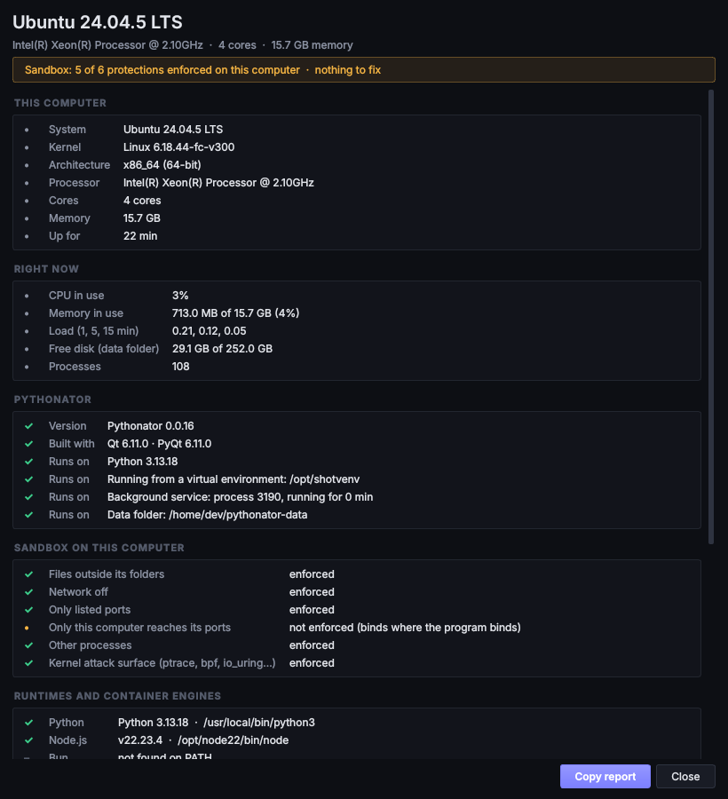

# Security

This page describes what Pythonator protects, against which threats, how each protection is enforced, and where the
limits are. Security problems should be reported through
[a private advisory](https://github.com/cfunkz/Pythonator/security/advisories/new), not a public issue; see
[SECURITY.md](../SECURITY.md).

## Threat model

| Threat | Protection |
| --- | --- |
| A service is malicious, or is compromised (a malicious dependency, a remote code execution bug) | Sandbox or Container mode: it cannot read the user's files and keys, write outside its folder, listen on other ports, reach the desktop session, or interact with other programs |
| A service tries to read Pythonator's data (the token, other services' logs) | The data folder is never granted in any mode except Full access, and is private to the user's account |
| A service writes where code runs as the user | Sandbox and Container modes refuse, as a service's folder or a write grant: the home folder itself, Pythonator's data and program folders and the Python it runs on, system folders (`/usr`, `/etc`, `/Applications`, `Program Files`, `ProgramData`, `C:\Windows`), folders on `PATH`, login autostart folders and shell start files, and folders of keys. Full access is not limited: it is confirmed once per service and shown in red |
| A plugin is malicious | Plugins run in their own sandbox (official ones too: no plugin starts where the sandbox can't be set up), receive only what their permissions allow, start in test mode when third-party, and are disabled when they flood, send malformed messages or crash repeatedly; ending one ends every process it started |
| An official plugin is replaced or modified | *Official* means the files match the reviewed SHA-256 catalogue; a single changed byte makes the plugin third-party, with the warning, test mode and no permissions. Files that change after verification are treated as new code |
| Another local account, or another program, talks to the background service | The socket is restricted to the user's account (mode 0600, or a per-user named pipe) and requires a random token from a file only the user can read; the token is compared in constant time |
| A crafted message to the background service | Every request is a strict typed model with limits; unknown fields are refused; a line is at most 1 MB; a slow client is cut off, never waited for |
| A cloned repository runs code on clone or pull | Hooks, submodules and fsmonitor disabled; only `https` and `ssh` transports (`GIT_ALLOW_PROTOCOL`, which a checkout's own settings can't override); addresses validated; fast-forward only; a pull fetches only the Git address and branch saved in the service's settings (never the checkout's own `origin`), refuses a checkout whose `.git/config` holds settings that would run a program (`core.sshCommand`, filter drivers, `credential.helper`, `include.path`) or whose `.git` holds a link, a hard link, a FIFO or an `alternates` file (git, running as the user, would write through it), checks it again before the merge, has a real timeout that ends git and its helpers, and waits until nothing sandboxed runs in that folder or may write it through *More folders*. See [Git](git.md) |
| A sandboxed service modifies its own folder to escape | Nothing in the project folder runs outside the sandbox: the venv's Python version is read from `pyvenv.cfg` rather than by running it; `pyvenv.cfg` and symbolic links can only point the sandbox at a real Python installation; an env file is read only if it resolves inside the folder, and cannot set `PATH`, `HOME`, `LD_*`, `DYLD_*`, `DOCKER_*`, `XDG_*`, `PYTHONPATH` and similar variables; a sandboxed service must be stopped before a pull |
| Arguments that look different from what runs | Programs start from argument lists, never a shell; NUL, bidirectional-override and zero-width characters are refused |
| `LD_PRELOAD` and similar variables | Refused as service variables |
| Secrets in the user's own environment | Inherited variables named like secrets (`GITHUB_TOKEN`, `AWS_SECRET_ACCESS_KEY`, `*_API_KEY`, `*PASS*`, `*AUTH*`, `*ACCESS_KEY*`, `DATABASE_URL`, `*DSN*`, `*SESSION*`, `*WEBHOOK*`) and any inherited value that is an address with a password in it are not passed to sandboxed services or plugins; they can be set on the service explicitly when needed. A secret under another name (`DISCORD`) is still passed: keep secrets out of the environment Pythonator starts in, and set them on the service |
| Secrets in output | Values of secret-looking variables are masked in the console, logs and plugin messages. What plugins receive (and may pass on to an AI provider or a webhook) is also masked for every value of 6 or more characters in the service's variables and env file, whatever its name, and for the password in a URL such as `DATABASE_URL` |
| Pythonator itself crashes | On Windows every service ends with the background service, Full access too (each runs in a job object that closes with it). On Linux and macOS services keep running, except sandboxed ones under bubblewrap; the next start ends them, identified by process ID and start time. Nothing restarts the background service by itself yet |

## Sandbox enforcement

### Linux

* **[Landlock](https://docs.kernel.org/userspace-api/landlock.html)** (kernel 5.13+; network rules 6.7+, scoping
  6.12+): the service may read the system folders, its runtime's installation and its project, and write its project
  and its private home and temporary folders, and nothing else. With the network on, it may listen only on the
  listed TCP ports; outbound connections may go to any port. Signals and abstract Unix sockets outside its own
  sandbox are refused.
* **[seccomp](https://man7.org/linux/man-pages/man2/seccomp.2.html)** (through `libseccomp`): with the network off,
  no sockets except Unix sockets. Always blocked: `ptrace`, `bpf`, `io_uring`, kernel module loading, `kexec`,
  `perf_event_open`, `userfaultfd`, mounts, joining other namespaces, and injecting terminal input
  ([`TIOCSTI`](https://man7.org/linux/man-pages/man2/ioctl_tty.2.html)). New Unix sockets are also blocked without
  bubblewrap, and with it when the network is on but Landlock cannot scope them (before Linux 6.12), since they
  would reach the desktop session (X11, D-Bus).
* **Neither seccomp nor bubblewrap:** Sandbox mode refuses to start. Landlock alone doesn't stop a connection to a
  Unix socket by its path, so the session bus (which can start programs outside the sandbox), `docker.sock` and the
  SSH agent would be reachable. Install `libseccomp2` (present on almost every desktop distribution) or bubblewrap.
* **Devices:** only `/dev/null`, `zero`, `random`, `urandom`, `tty`, `ptmx` and `shm`; no cameras or microphones.
  `/dev/pts` is available only inside bubblewrap, where it is the sandbox's own.
* **Stopping:** nothing leaves the service's process group. seccomp makes `setsid` and `setpgid` report success and
  change nothing, so Stop and the clean-up after an exit reach every process the service ever started, even one that
  daemonised. Under bubblewrap the service's own PID namespace ends with it as well.
* **[bubblewrap](https://github.com/containers/bubblewrap)**, when installed and permitted to create
  [user namespaces](https://man7.org/linux/man-pages/man7/user_namespaces.7.html): a private `/tmp`; new PID, IPC and
  UTS namespaces; only the required folders mounted; all capabilities dropped; and the service dies with its parent.

Each layer works independently, and **System check** shows which are active. Ubuntu 24.04 and later restrict
unprivileged user namespaces with AppArmor
([details](https://ubuntu.com/blog/ubuntu-23-10-restricted-unprivileged-user-namespaces)); the distribution's
`bubblewrap` package includes the profile it needs.

### macOS

A Seatbelt profile, passed to `sandbox-exec`, that denies by default and allows the same folders. Every path is
passed as a parameter rather than inserted into the profile text. Network: outbound connections only when enabled,
and listening only on the listed ports, on `127.0.0.1` unless *Other computers* is chosen. Terminal devices
(`/dev/ttys*`) are not accessible. Apple marks `sandbox-exec` as deprecated but uses the same mechanism for its own
[App Sandbox](https://developer.apple.com/documentation/security/app-sandbox); if it is ever removed, System check
reports *not enforced* and services do not start in Sandbox mode.

### Windows

* An **[AppContainer](https://learn.microsoft.com/en-us/windows/win32/secauthz/appcontainer-isolation)** per service:
  a separate security identity with no access to the user's files unless granted. Pythonator grants the project and
  runtime folders, records each grant, and revokes them when the service is removed.
* A **[job object](https://learn.microsoft.com/en-us/windows/win32/procthread/job-objects)** per service, with *kill
  on job close*. The program starts suspended, is assigned to the job, and only then resumes, so every process it
  starts is inside the job. A process that cannot be assigned is never resumed.
* Network capabilities only when the network is on. Inbound connections need
  [Make reachable](networking.md#windows-make-reachable), which adds a loopback permit and firewall rules for that
  AppContainer only, for `127.0.0.1` and, if requested, private networks. Removing the service removes them (one
  administrator prompt), and **System check** finds any left behind by a cancelled prompt.
* Python services get a `sitecustomize` module that makes `os.mkdir(..., 0o700)` work in the AppContainer. Since
  the fix for [CVE-2024-4030](https://nvd.nist.gov/vuln/detail/CVE-2024-4030) (Python 3.12.4), that mode gives the
  folder permissions without an entry for the AppContainer, so `tempfile`, `ensurepip` and `pip` would fail. The
  folder gets the ordinary permissions of the folder it is made in, which only the service and you hold.
* WSL's own `bash.exe` and `wsl.exe` in System32 are refused in Sandbox mode: they would run the script inside WSL,
  out of the AppContainer's reach. Git for Windows' bash works.

### Containers

Docker or Podman with all capabilities dropped, `no-new-privileges`, a read-only image, a process limit, only the
project mounted, and `--network none` when the network is off; see [Container](isolation.md#container). A container
is only as strong as its engine: rootless Podman offers more protection than a Docker daemon running as root
([Docker security](https://docs.docker.com/engine/security/)).

## Limitations

* **Full access is not a sandbox.** Pythonator asks once per service and shows the mode in red.
* **A sandbox is not a virtual machine.** A kernel vulnerability can defeat any sandbox on the same kernel. Container
  mode on a VM-based engine (Docker Desktop, Podman machine) adds that layer.
* **Linux cannot restrict the listening address**, only the port. A service given `HOST=127.0.0.1` can still bind
  `0.0.0.0`; use a firewall, or Container mode.
* **Outbound network access is all or nothing.** A service with the network on can connect to any address and port,
  including servers on this computer such as a database on `127.0.0.1`. The [Guard](plugins.md#guard) plugin can
  monitor connections.
* **macOS can't keep every process in a service's group.** A program that starts a new session (`setsid`) is still
  found and ended by a marker in its environment, unless it also replaces its whole environment.
* **Pythonator does not scan code.** It contains what runs; it does not judge whether the code is trustworthy.
* **It runs as the user.** It neither needs nor should have administrator rights, and System check warns when it has
  them.

## Supply chain

* Six direct runtime dependencies, all widely used. `requirements.lock` pins every package, direct and indirect, with
  SHA-256 hashes ([pip hash-checking mode](https://pip.pypa.io/en/stable/topics/secure-installs/)).
* Every change, and a weekly scheduled run, checks the lock files with
  [pip-audit](https://github.com/pypa/pip-audit). CodeQL's default set-up is enabled in the repository settings.
  Dependabot proposes updates after a 7-day
  [cooldown](https://docs.github.com/en/code-security/dependabot/working-with-dependabot/dependabot-options-reference),
  so a newly published malicious version is not picked up the same day.
* PyQt6 6.12.0 is excluded because its type stubs are broken; Qt's JSON parsers are not used at all.
* GitHub Actions are pinned to commit hashes, and workflows run with read-only permissions by default.
* Release artefacts ship with `SHA256SUMS.txt` and signed build provenance
  ([actions/attest](https://github.com/actions/attest)).

## Reporting

Please report problems privately through
[GitHub security advisories](https://github.com/cfunkz/Pythonator/security/advisories/new). [SECURITY.md](../SECURITY.md)
lists what to include and what to expect.
