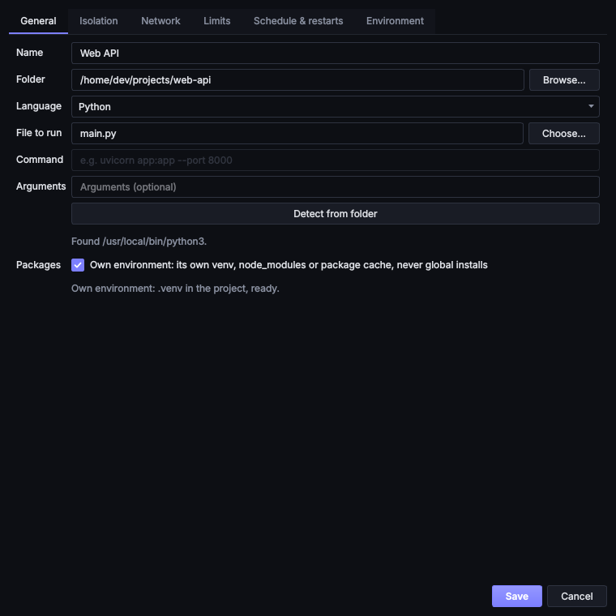
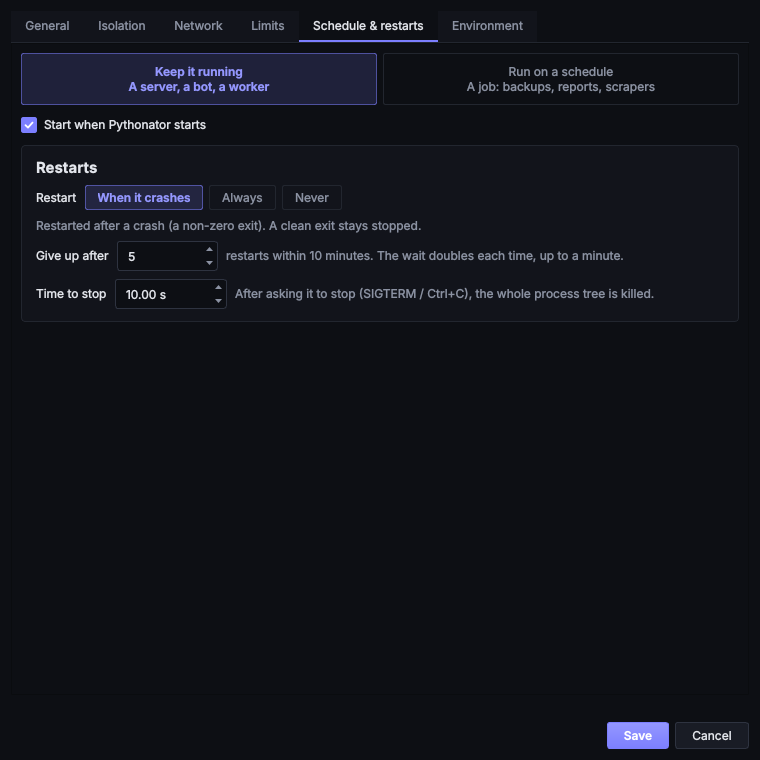
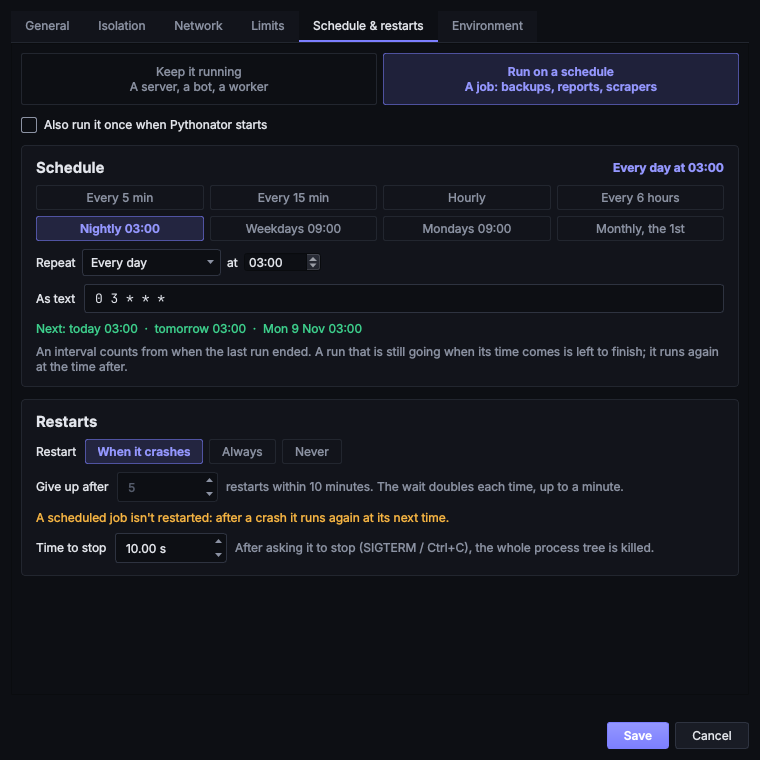
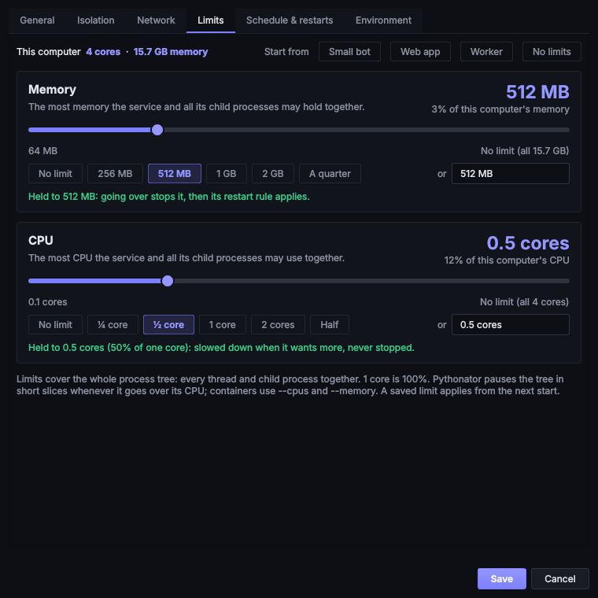
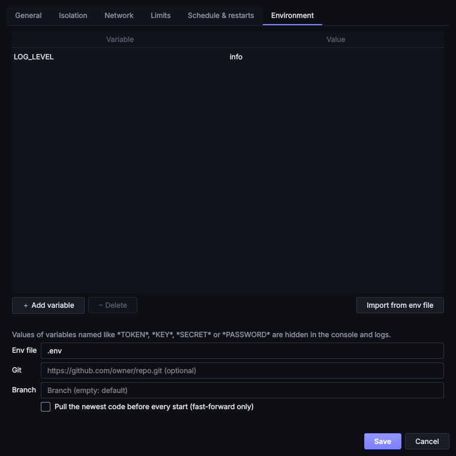
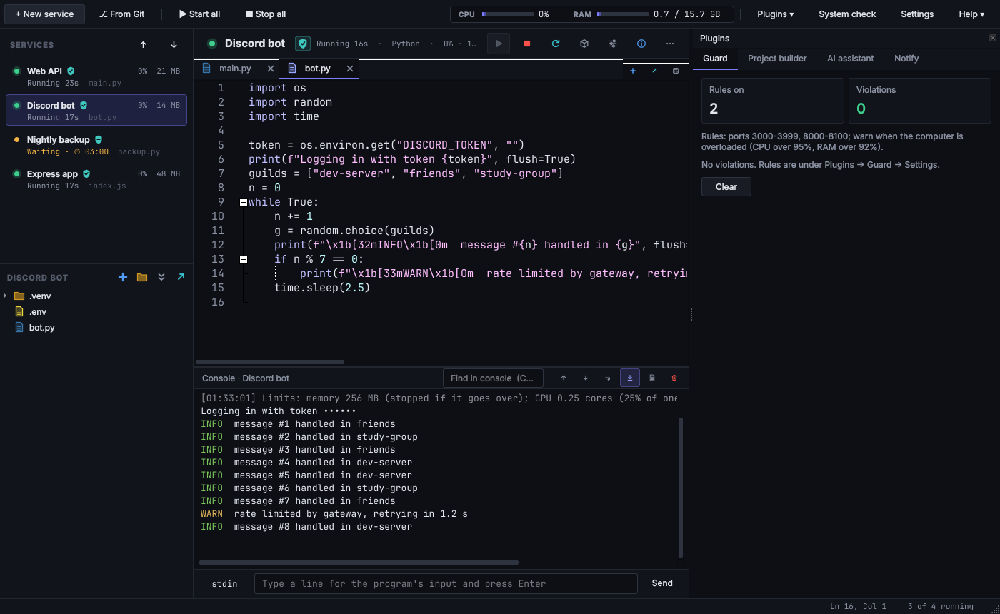
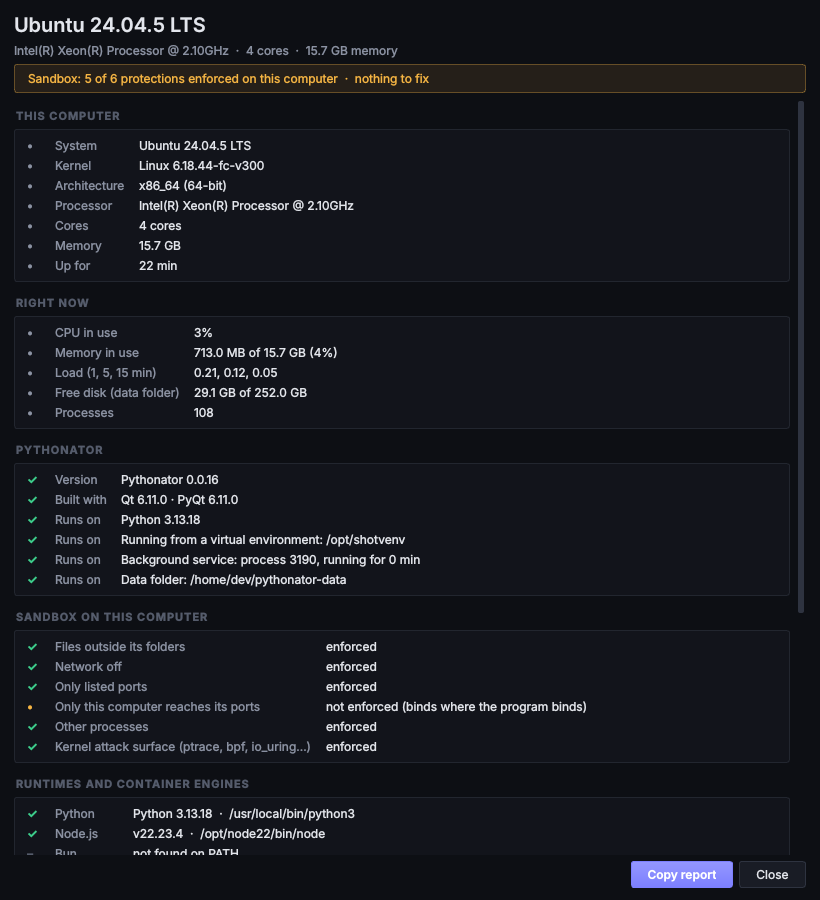

# Services

A service is one program supervised by Pythonator. It is either a **file to run** in a supported language
(`bot.py`, `server.js`, `main.go`, `app.jar`, …) or a **custom command** (`uvicorn app:app --port 8000`,
`./my-binary --serve`), and it belongs to a project **folder**.

Services are created with **+ New service** and edited with **Configure** (<kbd>Ctrl</kbd>+<kbd>E</kbd>). The
settings are split across the tabs described below; [Isolation](isolation.md) and [Network](networking.md) have
pages of their own.

## General

| Field | Meaning |
| --- | --- |
| Name | Shown in the list. Letters, digits, spaces and `. _ - ( )`, up to 64 characters |
| Folder | The project folder. The program starts in it, and in Sandbox mode it is the folder the program may use |
| Language | Python, Node.js, Bun, Deno, Go, Java, .NET, Ruby, PHP, Rust, Shell, PowerShell, Docker Compose, or **Custom command** |
| File to run | Relative to the folder. May be empty where the language has a default (`npm start`, `go run .`, `cargo run`) |
| Command | Custom command only: the full command line, split as a shell would split it but never run through a shell |
| Arguments | Passed after the file |
| Own environment | A private `.venv`, `node_modules` or package cache for this service (on by default); see [Languages](languages.md) |

**Detect from folder** looks for a known entry file (`main.py`, `app.py`, `bot.py`, `index.js`, `main.go`, …),
then for project files (`package.json`, `go.mod`, `Cargo.toml`, `Gemfile`, …).

No shell is involved at any point. Arguments reach the program exactly as written, so quotes, `;`, `|` and `$( )` are
ordinary characters. Validation rejects invisible characters (NUL, right-to-left overrides, zero-width spaces) that
could make a command look different from what actually runs.

## Schedule & restarts

The tab begins with the kind of service:

* **Keep it running**: a server, bot or worker. When it exits, the restart rule decides what happens next.
* **Run on a schedule**: a job such as a backup, report or scraper. It runs, exits and waits for its next time; see
  [Schedules](#schedules).

**Start when Pythonator starts** starts the service whenever the background service starts. For a scheduled job the
option reads **Also run it once when Pythonator starts**: one immediate run, then the schedule.

### Restarts

| Setting | Meaning |
| --- | --- |
| Restart: When it crashes | Restarted after a non-zero exit code (the default). A clean exit leaves it stopped |
| Restart: Always | Restarted after every exit, including exit code 0 |
| Restart: Never | Left stopped when it exits |
| Give up after | Restarts allowed within 10 minutes before Pythonator stops trying; 0 means no limit |
| Time to stop | How long a stop waits for the program to exit before the process tree is killed |

The delay before each restart doubles, from 1 s to a maximum of 60 s. A service that ran for over a minute starts
again from the shortest delay. When the limit is reached the service shows **failed**, and
[Notify](plugins.md#notify) sends a single *gave up* alert rather than one per crash. The restart rules do not apply
to a scheduled job, which runs again at its next time instead.

**Stopping** sends Ctrl+C on Windows, or `SIGTERM` to the process group on macOS and Linux, waits for **Time to
stop**, then kills the whole process tree. Pressing **Stop** (or **Stop all**) a second time kills it immediately.
On Windows each service is in a [job object](glossary.md#job-object), so none of its child processes survive a stop.
Containers are stopped with `docker stop` or `podman stop`.

If Pythonator itself is killed, or the computer loses power, the next start finds the processes left running
(matched by process ID *and* start time, so a reused ID is never touched) and stops them.

## Schedules

A scheduled service runs, exits and waits for its next run. Between runs it shows **waiting** with the time of the
next run.

On **Schedule & restarts**, choose **Run on a schedule**, then one of:

* a preset: *Every 5 min*, *Every 15 min*, *Hourly*, *Every 6 hours*, *Nightly 03:00*, *Weekdays 09:00*,
  *Mondays 09:00* or *Monthly, the 1st*;
* the **Repeat** form: every *n* seconds, minutes, hours or days; every hour at a given minute; or every day, Monday
  to Friday, weekly on a given day or monthly on a given date, at a given time;
* **As text**, which is the form that is saved. A schedule the form cannot represent is shown as **Custom (cron)**.

The presets, the form and the text stay in sync. Above them the schedule is described in words (*Monday to Friday at
09:00*), and below them the next three runs are listed, or the reason the schedule cannot be parsed. An interval is
measured from the end of the previous run, and a run that is still going when the next is due is allowed to finish.

| Text | Runs |
| --- | --- |
| `every 30s`, `every 15m`, `every 6h`, `every 1d` | At that interval (10 seconds minimum) |
| `@hourly`, `@daily`, `@weekly`, `@monthly` | At the start of each hour, day, week or month |
| `0 3 * * *` | A [cron](https://man7.org/linux/man-pages/man5/crontab.5.html) expression, here 03:00 daily. Five fields: minute, hour, day of month, month, day of week. A sixth field for seconds is refused; a schedule saved with one before 0.0.18 loses its seconds field |
| `*/5 9-17 * * 1-5` | Every 5 minutes from 09:00 to 17:55, Monday to Friday |

Times are in the computer's local time zone. Cron expressions are evaluated with
[cronsim](https://github.com/cuu508/cronsim).

## Memory and CPU limits

Both limits are on the **Limits** tab. Both are optional and apply to the whole process tree, meaning every thread
and child process together. The console states at each start which limits apply and how they are enforced.

The top of the tab shows the computer's cores and memory, and profiles that set both limits: **Small bot** (256 MB,
a quarter of a core), **Web app** (1 GB, 1 core), **Worker** (2 GB, 2 cores) and **No limits**. Each limit has its own
card showing the value and its share of the computer. It can be set with the slider (fully right means no limit), one
of the preset sizes, or the text box. An empty box, or **No limit**, removes it.

* Memory: `512M`, `2G`, `1.5 GB`, or `800` (megabytes). The minimum is 16 MB; a value above the installed memory is
  reduced to the installed memory.
* CPU: cores (`0.5`, `1.5`, `2 cores`) or a percentage of one core (`150%`). The minimum is 5%; a value equal to or
  above the number of cores means no limit.

Input is validated as it is typed. The card shows how the value was read (for example *2 GB, 13% of this computer's
memory*) or, in red, what is wrong with it. A service cannot be saved with an unreadable limit.

### Memory limit

| Where | Enforcement |
| --- | --- |
| Windows | The job object's memory limit; Windows refuses the allocation that would exceed it |
| Containers | `--memory`, enforced by the engine |
| macOS and Linux | A watchdog checks the tree every 2 seconds and stops the service when it is over the limit |

### CPU limit

The CPU limit is expressed in percent of one core, as on the service card: 50 is half a core, 150 is one and a half
cores. A computer with 8 logical cores has 800 in total, and a limit at or above that is no limit. A single-threaded
program cannot exceed 100.

| Where | Enforcement |
| --- | --- |
| Windows | A hard CPU rate cap on the job object, applied by the Windows scheduler |
| Containers | `--cpus`, enforced by the engine |
| macOS and Linux (Sandbox and Full access) | The tree is measured twice a second; while it is over the limit it runs for only part of every 100 ms, paused with `SIGSTOP` and resumed with `SIGCONT` (the approach of [cpulimit](https://github.com/opsengine/cpulimit)). A service under its limit is never paused, and a stop resumes it first so that it can shut down cleanly |

The CPU limit stops one service from slowing the others. To protect the computer as a whole, enable
[Guard](plugins.md#guard), which watches total CPU and memory and acts on the service responsible for an overload.

## Environment

Variables are merged in this order, with later sources taking precedence:

1. Pythonator's own environment, without its internal variables. In a sandbox, desktop session variables (display,
   D-Bus and SSH agent sockets) and inherited variables named like secrets (`GITHUB_TOKEN`, `*_API_KEY`, …) are also
   removed.
2. The service's **env file**, for example `.env` in the project: `KEY=value` lines, `#` comments, optional quotes and
   `export`. The file must resolve to a path inside the project folder.
3. The **Environment** table.

In the service window, **＋ Add variable** adds a row, **− Delete** (or the Delete key) removes the selected rows, and
**Import from env file** copies the env file's variable names into the table, keeping existing values.

Pythonator sets `PYTHONUNBUFFERED=1` and `FORCE_COLOR=1`, so output appears immediately and in colour. When a port is
listed it also sets `PORT` to the first port and, if only this computer may connect, `HOST=127.0.0.1`.

`LD_PRELOAD`, `LD_AUDIT` and the `DYLD_` variables, which inject code into every program, are refused. An env file
also cannot set variables that would affect the launcher or the container engine (`PATH`, `HOME`, `LD_*`,
`DOCKER_*`, `XDG_*` and others); see [Security](security.md).

## Console and logs

The console shows output as it arrives, with ANSI colours. The input line at the bottom sends text to the program's
standard input; the **stdin / shell** switch (<kbd>Ctrl</kbd>+<kbd>\`</kbd>) runs a command instead, in the
service's folder, isolation and environment, while the service keeps running. **Wrap** wraps long lines.

Right-clicking a service offers **Configure…**, **Open folder**, **Copy address** (for a server), **Open log**,
**Clear console**, **Move up**, **Move down** and **Remove…**.

The values of variables whose names look secret (`TOKEN`, `SECRET`, `PASSWORD`, `API_KEY`, `…_KEY`, `PRIVATE`,
`CREDENTIAL`) and that are at least 6 characters long are replaced with `••••••` before output is displayed, logged or
passed to a plugin.

Each service has a log in `logs/` in the [data folder](getting-started.md#the-data-folder). It rotates at 10 MB and
keeps 3 old files (both configurable under **Settings**). When a program writes faster than the window can draw,
the console shows only the newest output and says so; the log still receives every line.

## Install packages

**Packages ▾ → Install packages** prepares the project for its language, inside the service's own isolation. A
sandboxed service installs in its sandbox, with the network enabled for the install.

| Language | Steps |
| --- | --- |
| Python | Creates `.venv` (or repairs a broken one), then `pip install -r requirements.txt` or `pip install -e .` |
| Node.js | `npm ci` if there is a `package-lock.json`, otherwise `npm install`; `pnpm` or `yarn` if their lock file is present |
| Bun | `bun install` |
| Go | `go mod download` |
| .NET | `dotnet restore` |
| Ruby | `bundle install` into `vendor/bundle` |
| PHP | `composer install` into `vendor` |
| Rust | `cargo fetch` |

Python services then run with the project's `.venv` automatically. See [Languages](languages.md).

## Environment check

Before each start the console lists anything likely to make the start fail: the runtime is not installed, the file to
run is missing, a `package.json` without `node_modules`, a Python project without a virtual environment, or a venv
whose base Python has been removed. It also compares the runtime version with the version the project declares.

**System check** in the toolbar covers Pythonator itself: which Python runs it, whether it runs from a virtual
environment, whether it runs with administrator rights (it should not), and which sandbox protections the computer
enforces.

Its **Left behind by services** section finds anything that can keep a port open after a service has gone, and
**Clean up…** removes it:

* a process still listening on a port that was started for a removed or stopped service. Each service's processes
  carry the `PYTHONATOR_SERVICE` variable, which identifies a program that left its process tree or was left running
  by a crash of the background service;
* a Docker or Podman container of Pythonator's still running for a removed or stopped service, holding its
  published ports;
* on Windows, the firewall rules, loopback exemption and loopback permit added by
  [Make reachable](networking.md#windows-make-reachable) for a service that no longer exists. Removing a service
  undoes these itself, so they are only found if that administrator prompt was cancelled. Removing them needs one
  administrator prompt.

Finding them needs no administrator rights. Since removing a service already stops its process tree and containers,
the section is normally empty.
